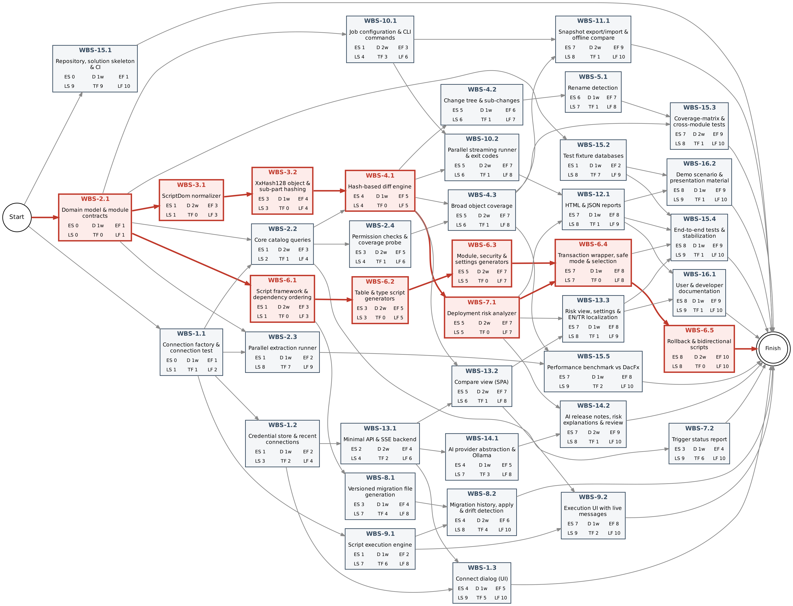
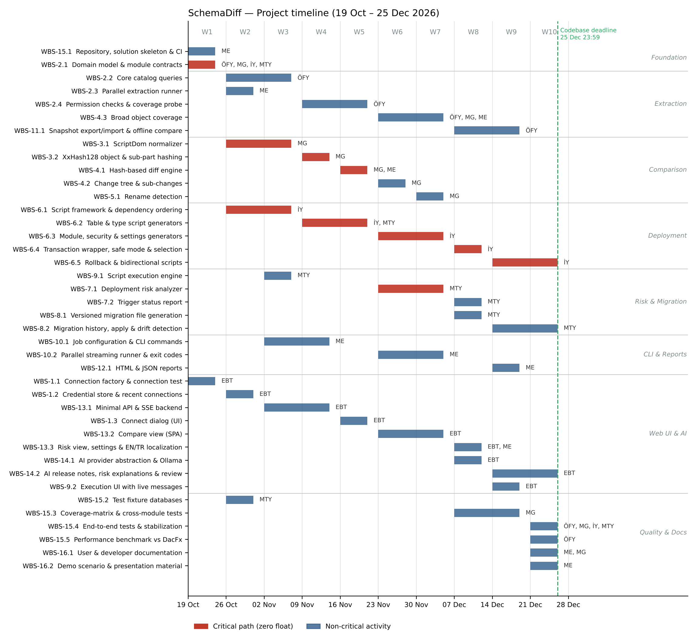

# Project Plan

**SchemaDiff — Fast SQL Server Schema Comparison, Deployment & Migration Tool**

| | |
|---|---|
| **Course** | BLG411E — Software Engineering (2026–2027 Fall Term) |
| **Report name** | Project Plan |
| **Project title** | SchemaDiff — Fast SQL Server Schema Comparison, Deployment & Migration Tool |
| **Group name** | SegFault |
| **Group members** | Mehmet Elhan — 150220013 Ömer Faruk Yılmaz — 150220057 Mücahit Günay — 150220027 İsmail Yeşilyurt — 150220009 Mustafa Talha Yıldırım — 150220008 Enes Birol Tatlı — 150230713 |
| **Product Owner** | İsmail Yeşilyurt (150220009) |
| **Instructors** | Prof. Dr. Tolga Ovatman, Assoc. Prof. Dr. Ayşe Tosun |
| **Submission date** | 2026-10-19 |
| **Document version** | 1.0 |

---

## 1. Introduction

### 1.1 Scope

**Project overview.** Teams that run several environments (dev, test, prod) of the same SQL Server databases need to know exactly what differs between them and how to deploy those differences safely. Existing tools such as DacFx / SSDT Schema Compare build a full semantic model and can take minutes on databases with 10,000+ objects. SchemaDiff answers "what changed between two SQL Server databases?" in seconds by extracting the system catalog in bulk, normalizing T-SQL with ScriptDom and comparing objects through XxHash128 hashes. It then turns the result into a safe, dependency-ordered deployment script, analyzes deployment risk (data loss on non-empty tables), produces rollback scripts and versioned migration files with a history table, and offers an optional AI assistant that explains changes and risks in plain language. Intended users are database developers, DBAs, BI/ETL developers and release managers in SQL Server-based enterprise systems (banking, insurance, telecom, layered data warehouses). The tool is delivered as a CI-friendly CLI and a local web interface.

**In scope:**

- Connection management: SSDT-style connect dialog, connection test, database list, recent connections, DPAPI-protected password storage.
- Bulk catalog extraction (~50 read-only queries on parallel connections, global concurrency limit, graceful degradation, VIEW DEFINITION detection → "uncertain", never "equal").
- ScriptDom token-based normalization and XxHash128 hashing per object and per sub-part; Add/Delete/Change classification with sub-change drill-down.
- Broad object coverage: schemas, tables (computed/identity/sparse/temporal columns, defaults), all index kinds, statistics, constraints, views, procedures, functions, DML/DDL triggers, sequences, synonyms, user-defined and table types, partition functions/schemes, XML schema collections, roles, permissions, extended properties, plan guides, database scoped configurations.
- Rename detection (reported as candidates).
- Deployment script generation: dependency ordering, token-level CREATE→ALTER, single XACT_ABORT transaction, safe mode, per-object selection, rollback and bidirectional scripts.
- Deployment risk analysis with target row counts; trigger enabled/disabled status report.
- Migration generation (`V###__description.sql` + rollback), `__SchemaDiffMigrations` history table with checksums, apply pending, drift detection.
- Script execution from the web UI with GO-batch splitting and SSMS-style live messages.
- Multi-job orchestration and CLI (`jobs.json`, selection expressions, parallel streaming runs, exit codes 0/1/2, coverage probe).
- Snapshot export and offline compare; HTML/JSON reporting.
- Local SPA laid out like SSDT Schema Compare with live SSE progress and full EN/TR localization.
- AI assistant (release notes, risk explanations, script review) on schema metadata only, local model by default.
- Testing and quality (test-first approach): xUnit tests, coverage-matrix test, end-to-end fixtures, DacFx benchmark, GitHub Actions CI.

**Optional scope** (delivered only if the critical path keeps its schedule):

- Optional OpenAI-compatible cloud LLM provider in addition to the local Ollama model.
- Snapshot-vs-snapshot comparison (both sides offline).
- Light/dark theme switch in the web interface.
- Publishing self-contained release binaries from GitHub Actions.

**Out of scope:**

- Data comparison and data synchronization/migration (row-level diff, data transfer).
- Database systems other than Microsoft SQL Server / Azure SQL.
- Table rebuilds for column order changes and physical placement changes (`ON [filegroup]`).
- Automatic DDL for CLR assemblies/types, Always Encrypted keys and in-memory OLTP objects (detected and reported only).
- Automatic `sp_rename` generation for detected renames (reported only).
- Database users and logins (environment-specific; ignored by default).
- Multi-user deployment of the web interface (authentication, network exposure, cloud hosting); the tool runs on 127.0.0.1.
- Orchestration of other release steps (SSIS deployment, SQL Agent jobs, SSISDB parameters).
- Visual Studio / VS Code extension packaging.
- AI-driven automatic changes to databases; the assistant only explains and suggests.

**Assumptions and constraints.**

- **Time:** development runs 10 weeks, from Monday 2026-10-19 to Friday 2026-12-25 (codebase deadline 25.12.2026 23:59); demo on 26.12 and presentation on 28.12. Course reports (Requirements Specification 02.11, Requirements Analysis 23.11, Design 07.12, Test 21.12) are produced in parallel and are not scheduled as WBS activities.
- **Team:** six students with a baseline allocation of 0.5 FTE (≈20 h/week) each; up to 0.75 FTE in selected weeks from week 6 on, after the midterm (Mon 23 Nov, after 17:00). Each member has one technical and one management duty (Section 4.1).
- **AI agents:** AI coding agents are used as team members under the course policy: their work, effort and the human review effort are reported, Gen-AI error types are logged, and no member or agent commits directly to main (Sections 3 and 4.3).
- **Process:** test-first implementation, GitHub branches + pull requests, GitHub Actions CI and a GitHub Projects board for task tracking; customer (TA) meetings are minuted and needs confirmed before moving on.
- **Technology:** .NET 8 / C# 12, ASP.NET Core Minimal API + SSE, Microsoft.Data.SqlClient, ScriptDom, System.IO.Hashing, DPAPI (Windows), vanilla JavaScript SPA, Microsoft.Extensions.AI with Ollama; target SQL Server 2016+ / Azure SQL; tests on SQL Server LocalDB.
- **Budget:** zero; only free/open-source tools, LocalDB/Developer edition and local open-weight models.
- **Access:** no production databases are used; all testing uses scripted fixture databases.

### 1.2 Deliverables

Deliverables are the product components the team builds; documentation is a deliverable in its own right (D-07).

| ID | Deliverable | Description / contents | Acceptance criterion |
|---|---|---|---|
| D-01 | SchemaDiff Core Engine library | Connection layer, bulk catalog extractor, ScriptDom normalizer, XxHash128 hasher, hash-based comparer with change tree, rename detection, snapshot export/import (.NET 8 class library). | Compares every fixture database pair with the expected Add/Delete/Change result; unreadable objects reported as "uncertain"; snapshot round-trip equals live extraction. |
| D-02 | Deployment, Risk & Migration module | Dependency-ordered script generators, safe mode, rollback and bidirectional scripts, deployment risk analyzer, trigger status report, versioned migration files with history table, script execution engine. | Generated scripts deploy cleanly in a single XACT_ABORT transaction on fixture targets and roll back to the original schema; all known data-loss cases are flagged. |
| D-03 | Command-line application & reports | CI-friendly CLI with jobs.json multi-job configuration, selection expressions, parallel streaming runs, exit codes, coverage probe, offline snapshot compare, HTML/JSON reports. | Exit codes 0/1/2 verified in a GitHub Actions job; HTML/JSON reports open standalone and match the comparison result. |
| D-04 | Local web application | ASP.NET Core Minimal API + SSE backend bound to 127.0.0.1 and a vanilla-JS SPA laid out like SSDT Schema Compare (connect dialog, result tree, side-by-side diff, risk view, settings, script execution, EN/TR). | Full compare → review → script → execute flow completed on fixtures in the browser; all UI strings available in EN and TR; session disposed on tab close. |
| D-05 | AI assistant module | Pluggable Microsoft.Extensions.AI integration (local Ollama by default, optional OpenAI-compatible provider) producing release notes, risk explanations and script review comments from schema metadata only. | Produces structured output for fixture comparisons with a local model; no row data in prompts (verified by prompt-logging test); tool works normally when AI is disabled. |
| D-06 | Test suite, fixtures & benchmark | xUnit unit/integration tests, coverage-matrix test, scripted dev/prod/layered fixture databases, end-to-end tests, BenchmarkDotNet comparison against DacFx, GitHub Actions CI. | CI green on main; ≥80% line coverage on Core; every object kind scripted or explicitly reported; benchmark results recorded. |
| D-07 | Documentation | README, CLI reference, web UI user guide, architecture and module documentation, configuration samples, demo scenario, plus the course reports. | A new user can install, configure jobs.json and run a compare using only the documentation; reviewed by at least two members. |

### 1.3 Functional Requirements / Tasks

Every task is mapped to at least one deliverable.

| Task ID | Functional requirement / task | Description | Related deliverable(s) |
|---|---|---|---|
| T-01 | Connection management | SSDT-style connect dialog, connection test, database list from server, recent connections, DPAPI-protected password storage. | D-01, D-04 |
| T-02 | Bulk catalog extraction | One read-only query per object class on parallel connections with a global concurrency limit; graceful degradation; VIEW DEFINITION detection ("uncertain", never "equal"). | D-01 |
| T-03 | Normalization & hashing | ScriptDom token-based normalization (whitespace/comment/case options) and XxHash128 hashes per object and per sub-part. | D-01 |
| T-04 | Hash-based comparison & object coverage | Add/Delete/Change classification, change tree with sub-changes, coverage of all object kinds listed in the charter. | D-01 |
| T-05 | Rename detection | Heuristic pairing of removed+added objects with identical structure, reported as rename candidates. | D-01 |
| T-06 | Deployment script generation | Dependency-ordered script, token-level CREATE→ALTER, single XACT_ABORT transaction, safe mode, per-object selection, rollback and bidirectional scripts. | D-02 |
| T-07 | Deployment risk analysis | Classify table changes with target row counts; round uncertain cases to the riskier side; trigger status report across environments. | D-02, D-04 |
| T-08 | Migration generation & history | Versioned `V###__description.sql` files with rollback, `__SchemaDiffMigrations` history table with checksums, apply pending, drift detection. | D-02, D-03 |
| T-09 | Script execution | Execute generated scripts with GO-batch splitting and SSMS-style live messages (PRINT, rows affected, errors with line numbers). | D-02, D-04 |
| T-10 | Multi-job orchestration & CLI | Named jobs in jobs.json, interactive/expression selection, parallel streaming runs, exit codes 0/1/2, coverage probe command. | D-03 |
| T-11 | Snapshot export & offline compare | Save a database snapshot to a compressed file and compare a live database against it. | D-01, D-03 |
| T-12 | Reporting | Standalone HTML and JSON reports of comparison and risk results. | D-03 |
| T-13 | Web interface | Local SPA: selectors, grouped result tree, side-by-side diff, risk view, settings, live SSE progress, EN/TR, session cleanup. | D-04 |
| T-14 | AI assistant | Release notes, risk explanations and script review comments from schema metadata; pluggable providers, local by default. | D-05 |
| T-15 | Testing & quality | CI pipeline, fixture databases, unit/coverage-matrix/end-to-end tests, DacFx benchmark. | D-06 |
| T-16 | Documentation & release | User and developer documentation, demo scenario and presentation material. | D-07 |

### 1.4 Non-functional Issues

| Quality attribute | Requirement / concern | How it will be assessed |
|---|---|---|
| Security | Passwords stored only with Windows DPAPI; extraction uses read-only catalog queries; web API bound to 127.0.0.1 with per-tab sessions; AI prompts contain schema metadata only, never row data; deployment runs only after explicit user action. | Unit test scanning config/logs/reports/prompts for secrets; code review checklist; manual check that the server refuses non-loopback connections. |
| Performance | Full comparison of a 10,000+ object database pair in seconds (target ≤ 30 s on a local network, ≥ 5× faster than DacFx); UI shows first progress within 1 s via SSE. | BenchmarkDotNet run against DacFx on a generated 10k-object database (WBS-15.5); timing log in E2E tests. |
| Usability | Layout familiar to SSDT users (source ⇄ target, grouped tree, side-by-side diff); full EN/TR localization; CLI with help text and clear exit codes. | Walk-through with 3 external users completing compare → script tasks without help; localization completeness check. |
| Reliability | Unreadable objects are "uncertain", never "equal"; generated scripts run in one XACT_ABORT transaction; rollback scripts restore the original schema; uncertain risks rounded to the riskier side. | Coverage-matrix test; apply → rollback round-trip tests on fixtures; fault-injection tests for lost connections. |
| Maintainability | Modular Core / CLI / Web / AI projects behind agreed interfaces; ≥ 80% line coverage on Core. | CI coverage report; pull-request reviews. |
| Compatibility | SQL Server 2016+ and Azure SQL; optional queries degrade gracefully on older versions or missing permissions. | Test matrix with SQL Server 2016 and LocalDB; low-privilege login fixture. |

---

## 2. Project Plan — Work Breakdown Structure (WBS)

Each task from Section 1.3 is decomposed into activities. Activity IDs follow the parent task number (WBS-*task.n*). Size scale: **T** = Tiny · **S** = Small · **M** = Medium · **L** = Large · **XL** = Extra-large. Following the course's test-first practice, tests are written before or together with the code; every development activity is complete only when its xUnit tests pass in CI and its pull request is merged after review by another member.

| WBS ID | Parent | Activity / subtask | Description / completion condition | Size |
|---|---|---|---|---|
| WBS-1.1 | T-01 | Connection factory & connection test | SqlClient builder (Windows/SQL auth, encrypt, trust certificate), database list, connection test; tests pass on LocalDB. | S |
| WBS-1.2 | T-01 | Credential store & recent connections | Passwords encrypted with Windows DPAPI; recent connections persisted; test proves no plaintext on disk. | S |
| WBS-1.3 | T-01 | Connect dialog (UI) | SSDT-style dialog: server, authentication, encrypt/trust, database drop-down, test button, recent connections. | S |
| WBS-2.1 | T-02 | Domain model & module contracts | Object-kind catalogue, object/sub-part identity keys, snapshot and diff-result DTOs, extractor/comparer/generator/risk interfaces merged. | M |
| WBS-2.2 | T-02 | Core catalog queries | Bulk read-only queries for schemas, tables, columns, defaults, constraints, indexes, views, procedures, functions, triggers mapped to the model. | M |
| WBS-2.3 | T-02 | Parallel extraction runner | Parallel connections under a global concurrency limit with cancellation and progress events; fault-injection tests. | S |
| WBS-2.4 | T-02 | Permission checks & coverage probe | VIEW DEFINITION detection → "uncertain"; optional queries degrade on old versions/missing permissions; coverage probe report. | M |
| WBS-3.1 | T-03 | ScriptDom normalizer | Token-based normalization with whitespace/comment/case options; golden-file tests for formatting-only differences. | M |
| WBS-3.2 | T-03 | XxHash128 object & sub-part hashing | Deterministic hashes per object and per sub-part (columns, indexes, constraints, body, permissions); stability tests. | S |
| WBS-4.1 | T-04 | Hash-based diff engine | Add/Delete/Change classification of two snapshots; "uncertain" never equal; tests on fixture pairs. | M |
| WBS-4.2 | T-04 | Change tree & sub-changes | Hierarchical change tree with sub-changes (Add Column, Alter Column, Drop Index…) consumed by UI, CLI and generators. | S |
| WBS-4.3 | T-04 | Broad object coverage | Remaining classes (special indexes, sequences, synonyms, partitions, XML schema collections, roles, permissions, ext. properties, plan guides, DB scoped configs) extracted and compared. | L |
| WBS-5.1 | T-05 | Rename detection | Removed+added pairs with identical structural hash reported as rename candidates (no sp_rename generated). | S |
| WBS-6.1 | T-06 | Script framework & dependency ordering | Script builder and dependency graph ordering types → tables → modules → roles → permissions/ext. properties → settings; ordering tests. | M |
| WBS-6.2 | T-06 | Table & type script generators | CREATE/ALTER for tables (computed/identity/sparse/temporal, defaults), constraints, indexes, statistics, user-defined and table types. | L |
| WBS-6.3 | T-06 | Module, security & settings generators | Views/procedures/functions/triggers with token-level CREATE→ALTER, sequences, synonyms, roles, permissions, ext. properties, settings. | M |
| WBS-6.4 | T-06 | Transaction wrapper, safe mode & selection | Single transaction with XACT_ABORT ON; safe mode drops data-loss steps flagged by the analyzer; per-object include/exclude. | S |
| WBS-6.5 | T-06 | Rollback & bidirectional scripts | Inverse script per deployment and mixed-direction scripts per object; apply → rollback round trip restores fixture schema. | M |
| WBS-7.1 | T-07 | Deployment risk analyzer | Classifies table changes (type narrowing, column drop, NOT NULL w/o default…) with row counts from sys.dm_db_partition_stats; uncertain → riskier. | M |
| WBS-7.2 | T-07 | Trigger status report | Enabled/disabled trigger status compared across environments (CLI + UI). | T |
| WBS-8.1 | T-08 | Versioned migration file generation | Comparison saved as `V###__description.sql` with matching rollback file; naming/versioning tests. | S |
| WBS-8.2 | T-08 | Migration history, apply & drift detection | `__SchemaDiffMigrations` with checksums, list/apply pending via execution engine, drift between history and live schema. | M |
| WBS-9.1 | T-09 | Script execution engine | GO-batch splitter; execution capturing PRINT output, rows affected and errors with line numbers as an event stream. | S |
| WBS-9.2 | T-09 | Execution UI with live messages | Run the generated script from the web UI with SSMS-style live messages over SSE. | T |
| WBS-10.1 | T-10 | Job configuration & CLI commands | jobs.json schema, interactive and expression selection (1,3-5,name), compare/script/probe commands with help text. | M |
| WBS-10.2 | T-10 | Parallel streaming runner & exit codes | Selected jobs run in parallel, results streamed as each finishes; exit codes 0 (no diff) / 1 (diff) / 2 (error). | S |
| WBS-11.1 | T-11 | Snapshot export/import & offline compare | Compressed JSON snapshot with version header; round-trip equals live extraction; live-vs-snapshot compare in CLI and UI. | M |
| WBS-12.1 | T-12 | HTML & JSON reports | Standalone HTML and JSON export of comparison and risk results from CLI and UI. | S |
| WBS-13.1 | T-13 | Minimal API & SSE backend | Minimal API on 127.0.0.1, compare/progress endpoints over SSE, per-tab session store disposed via sendBeacon. | M |
| WBS-13.2 | T-13 | Compare view (SPA) | Source⇄target selectors, grouped result tree with checkboxes, side-by-side definitions with diff navigation, live SSE progress. | M |
| WBS-13.3 | T-13 | Risk view, settings & EN/TR localization | Deployment risk view, comparison/normalization settings panel, complete EN/TR resource strings. | M |
| WBS-14.1 | T-14 | AI provider abstraction & Ollama | Microsoft.Extensions.AI client, local Ollama default, optional OpenAI-compatible provider; graceful when disabled. | T |
| WBS-14.2 | T-14 | AI release notes, risk explanations & review | Prompt templates on JSON diff/risk metadata (no row data), structured output parsing, UI panel, script review comments. | M |
| WBS-15.1 | T-15 | Repository, solution skeleton & CI | GitHub repo, .NET 8 solution (Core/Cli/Web/Tests), conventions; GitHub Actions build+test workflow green on main. | S |
| WBS-15.2 | T-15 | Test fixture databases | Scripted dev/prod/layered (staging-core-mart) LocalDB fixtures with documented differences covering every object kind. | S |
| WBS-15.3 | T-15 | Coverage-matrix & cross-module tests | Coverage-matrix test (each object kind scripted or reported); normalization/comparison/risk/script suites; ≥80% Core coverage. | M |
| WBS-15.4 | T-15 | End-to-end tests & stabilization | CLI and web E2E runs on dev/prod/layered fixtures; all high-severity bugs closed; CI green. | M |
| WBS-15.5 | T-15 | Performance benchmark vs DacFx | BenchmarkDotNet run on a 10,000+ object database; results documented against the performance target. | S |
| WBS-16.1 | T-16 | User & developer documentation | README, CLI reference, web UI guide, architecture/module docs, configuration samples; peer-reviewed. | S |
| WBS-16.2 | T-16 | Demo scenario & presentation material | Self-contained release build, scripted demo on fixture databases, presentation slides. | T |

**WBS decomposition notes.** Activities were cut so that each one has a single clear owner, a verifiable completion condition and a size of at most L (no activity exceeds 2 man-weeks, which keeps progress visible week by week). WBS-2.1 (domain model and module contracts) is done first by the four core developers together; it freezes the snapshot and diff-result interfaces so that extraction, comparison, script generation, risk analysis, CLI and web work can proceed in parallel against fixture data instead of waiting for each other. Object coverage is split into "core" classes (WBS-2.2) and the remaining classes (WBS-4.3) so that the end-to-end pipeline works early. Script generation is the longest chain of dependent work (framework → table/type → module/security → transaction/safe mode → rollback). Testing is both embedded (each activity ships its unit tests) and explicit (fixtures, coverage matrix, end-to-end, benchmark).

*Course guideline note: user stories for these subtasks will be written in the separate Requirements Specification document; this project plan defines and sizes the subtasks.*

---

## 3. Estimates

| WBS ID | Size | Effort (man-weeks) | Basis / assumptions |
|---|---|---|---|
| WBS-1.1 | S | 0.5 | Small: one component, known APIs |
| WBS-1.2 | S | 0.5 | Small: one component, known APIs |
| WBS-1.3 | S | 0.5 | Small: one component, known APIs |
| WBS-2.1 | M | 1 | Joint design session + review of DTOs/interfaces |
| WBS-2.2 | M | 1 | Medium: several components or new API |
| WBS-2.3 | S | 0.5 | Small: one component, known APIs |
| WBS-2.4 | M | 1 | Medium: several components or new API |
| WBS-3.1 | M | 1 | ScriptDom API learning curve; golden-file corpus |
| WBS-3.2 | S | 0.5 | Small: one component, known APIs |
| WBS-4.1 | M | 1 | Medium: several components or new API |
| WBS-4.2 | S | 0.5 | Small: one component, known APIs |
| WBS-4.3 | L | 2 | ~35 remaining object classes; repetitive, AI-assisted |
| WBS-5.1 | S | 0.5 | Small: one component, known APIs |
| WBS-6.1 | M | 1 | Medium: several components or new API |
| WBS-6.2 | L | 2 | Many column/constraint/index variants; two developers |
| WBS-6.3 | M | 1 | Medium: several components or new API |
| WBS-6.4 | S | 0.5 | Small: one component, known APIs |
| WBS-6.5 | M | 1 | Inverse generation for every change type |
| WBS-7.1 | M | 1 | Pattern catalogue of data-loss cases + row counts |
| WBS-7.2 | T | 0.25 | Tiny: small, well-understood change |
| WBS-8.1 | S | 0.5 | Small: one component, known APIs |
| WBS-8.2 | M | 1 | History table, checksums, drift query |
| WBS-9.1 | S | 0.5 | Small: one component, known APIs |
| WBS-9.2 | T | 0.25 | Tiny: small, well-understood change |
| WBS-10.1 | M | 1 | Medium: several components or new API |
| WBS-10.2 | S | 0.5 | Small: one component, known APIs |
| WBS-11.1 | M | 1 | Medium: several components or new API |
| WBS-12.1 | S | 0.5 | Small: one component, known APIs |
| WBS-13.1 | M | 1 | Medium: several components or new API |
| WBS-13.2 | M | 1 | Largest UI screen (tree + side-by-side diff) |
| WBS-13.3 | M | 1 | Medium: several components or new API |
| WBS-14.1 | T | 0.25 | Tiny: small, well-understood change |
| WBS-14.2 | M | 1 | Prompt iteration and JSON-output parsing |
| WBS-15.1 | S | 0.5 | Small: one component, known APIs |
| WBS-15.2 | S | 0.5 | Small: one component, known APIs |
| WBS-15.3 | M | 1 | Medium: several components or new API |
| WBS-15.4 | M | 1 | Four members test in parallel in the final week |
| WBS-15.5 | S | 0.5 | Small: one component, known APIs |
| WBS-16.1 | S | 0.5 | Small: one component, known APIs |
| WBS-16.2 | T | 0.25 | Tiny: small, well-understood change |
| **Total** | — | **31** | 40 activities |

**Estimation method.** Each activity was first sized relative to the others (T-shirt sizing in a team session, using the charter's feature list and the team's experience with .NET and SQL Server). Sizes were then converted to effort with a fixed scale, calibrated so that it already includes the productivity gain from AI coding assistants (roughly 25–30% less implementation time than without them) but also the extra time for reviewing AI-generated code and writing tests:

| Size | T | S | M | L | XL |
|---|---|---|---|---|---|
| Effort (man-weeks) | 0.25 | 0.5 | 1 | 2 | 4 |
| ≈ hours | 10 | 20 | 40 | 80 | 160 |

**Effort versus duration.** Duration = effort ÷ total FTE allocated to the activity. For example WBS-6.2 (L, 2 man-weeks) has İY and MTY at 0.5 FTE each, so it takes 2 weeks; WBS-4.1 (M, 1 man-week) has MG and ME at 0.5 FTE each and takes 1 week. AI agents are treated as a productivity multiplier already contained in the effort figures, not as extra team members, because their output must be specified, reviewed and tested by a person. Team capacity is 6 members × 0.5 FTE × 10 weeks = 30 man-weeks at baseline, plus 2 man-weeks of planned peak allocation in weeks 6–10; the plan uses **31 man-weeks**, leaving about 1 man-week of reserve.

---

## 4. Resources

### 4.1 Team Structure and Member Roles

| Member | Student ID | Role(s) | Main responsibilities |
|---|---|---|---|
| Mehmet Elhan (ME) | 150220013 | Technical: Job Orchestration / CLI Developer · Management: Project Manager | Schedule tracking, weekly meetings, risk register; CI pipeline, multi-job configuration (jobs.json), parallel streaming runner, CLI commands, console/HTML/JSON reports |
| Ömer Faruk Yılmaz (ÖFY) | 150220057 | Technical: Catalog Extraction & Snapshot Engineer · Management: Configuration Manager | GitHub repository, branch protection, GitHub Projects board; catalog queries, parallel extraction with concurrency limits, permission checks, coverage probe, snapshot export/import |
| Mücahit Günay (MG) | 150220027 | Technical: Comparison Engine Developer · Management: QA & Code Review Lead | Review policy, coding and coverage standards; T-SQL normalization (ScriptDom), XxHash128 hashing, hash-based diff, change tree, rename detection, coverage-matrix tests |
| İsmail Yeşilyurt (İY) | 150220009 | Technical: Deployment Script Generation Developer · Management: Product Owner | Backlog ownership and acceptance; table/module/type/role/permission/extended-property/settings script generators, dependency ordering, rollback and bidirectional scripts |
| Mustafa Talha Yıldırım (MTY) | 150220008 | Technical: Risk Analysis & Migration Developer · Management: Customer Liaison & Meeting Secretary | Customer (TA) meeting minutes and confirmations; deployment risk analyzer, trigger status report, migration files and history table, script execution engine, test fixture databases |
| Enes Birol Tatlı (EBT) | 150230713 | Technical: Web UI & AI Integration Developer · Management: AI Usage & Reporting Coordinator | AI-agent usage logs, effort/token and error reporting; Minimal API + SSE backend, single-page web interface, connection management and DPAPI storage, AI assistant |

İsmail Yeşilyurt acts as Product Owner (accepts deliverables against the criteria in Section 1.2) in addition to his development role; Mehmet Elhan, as Project Manager, runs the weekly planning meeting, tracks the schedule and owns the risk register.

### 4.2 Member-to-Activity Assignment

| WBS ID | Assigned member | Responsibility | FTE | Weeks |
|---|---|---|---|---|
| WBS-1.1 | Enes Birol Tatlı (EBT) | Connection factory & connection test | 0.5 | W1 |
| WBS-15.1 | Mehmet Elhan (ME) | Repository, solution skeleton & CI | 0.5 | W1 |
| WBS-2.1 | Ömer Faruk Yılmaz (ÖFY) | Domain model & module contracts | 0.25 | W1 |
| WBS-2.1 | Mücahit Günay (MG) | Domain model & module contracts | 0.25 | W1 |
| WBS-2.1 | İsmail Yeşilyurt (İY) | Domain model & module contracts | 0.25 | W1 |
| WBS-2.1 | Mustafa Talha Yıldırım (MTY) | Domain model & module contracts | 0.25 | W1 |
| WBS-1.2 | Enes Birol Tatlı (EBT) | Credential store & recent connections | 0.5 | W2 |
| WBS-15.2 | Mustafa Talha Yıldırım (MTY) | Test fixture databases | 0.5 | W2 |
| WBS-2.2 | Ömer Faruk Yılmaz (ÖFY) | Core catalog queries | 0.5 | W2–W3 |
| WBS-2.3 | Mehmet Elhan (ME) | Parallel extraction runner | 0.5 | W2 |
| WBS-3.1 | Mücahit Günay (MG) | ScriptDom normalizer | 0.5 | W2–W3 |
| WBS-6.1 | İsmail Yeşilyurt (İY) | Script framework & dependency ordering | 0.5 | W2–W3 |
| WBS-10.1 | Mehmet Elhan (ME) | Job configuration & CLI commands | 0.5 | W3–W4 |
| WBS-13.1 | Enes Birol Tatlı (EBT) | Minimal API & SSE backend | 0.5 | W3–W4 |
| WBS-9.1 | Mustafa Talha Yıldırım (MTY) | Script execution engine | 0.5 | W3 |
| WBS-2.4 | Ömer Faruk Yılmaz (ÖFY) | Permission checks & coverage probe | 0.5 | W4–W5 |
| WBS-3.2 | Mücahit Günay (MG) | XxHash128 object & sub-part hashing | 0.5 | W4 |
| WBS-6.2 | İsmail Yeşilyurt (İY) | Table & type script generators | 0.5 | W4–W5 |
| WBS-6.2 | Mustafa Talha Yıldırım (MTY) | Table & type script generators | 0.5 | W4–W5 |
| WBS-1.3 | Enes Birol Tatlı (EBT) | Connect dialog (UI) | 0.5 | W5 |
| WBS-4.1 | Mücahit Günay (MG) | Hash-based diff engine | 0.5 | W5 |
| WBS-4.1 | Mehmet Elhan (ME) | Hash-based diff engine | 0.5 | W5 |
| WBS-10.2 | Mehmet Elhan (ME) | Parallel streaming runner & exit codes | 0.25 | W6–W7 |
| WBS-13.2 | Enes Birol Tatlı (EBT) | Compare view (SPA) | 0.5 | W6–W7 |
| WBS-4.2 | Mücahit Günay (MG) | Change tree & sub-changes | 0.5 | W6 |
| WBS-4.3 | Ömer Faruk Yılmaz (ÖFY) | Broad object coverage | 0.5 | W6–W7 |
| WBS-4.3 | Mücahit Günay (MG) | Broad object coverage | 0.25 | W6–W7 |
| WBS-4.3 | Mehmet Elhan (ME) | Broad object coverage | 0.25 | W6–W7 |
| WBS-6.3 | İsmail Yeşilyurt (İY) | Module, security & settings generators | 0.5 | W6–W7 |
| WBS-7.1 | Mustafa Talha Yıldırım (MTY) | Deployment risk analyzer | 0.5 | W6–W7 |
| WBS-5.1 | Mücahit Günay (MG) | Rename detection | 0.5 | W7 |
| WBS-11.1 | Ömer Faruk Yılmaz (ÖFY) | Snapshot export/import & offline compare | 0.5 | W8–W9 |
| WBS-13.3 | Enes Birol Tatlı (EBT) | Risk view, settings & EN/TR localization | 0.5 | W8 |
| WBS-13.3 | Mehmet Elhan (ME) | Risk view, settings & EN/TR localization | 0.5 | W8 |
| WBS-14.1 | Enes Birol Tatlı (EBT) | AI provider abstraction & Ollama | 0.25 | W8 |
| WBS-15.3 | Mücahit Günay (MG) | Coverage-matrix & cross-module tests | 0.5 | W8–W9 |
| WBS-6.4 | İsmail Yeşilyurt (İY) | Transaction wrapper, safe mode & selection | 0.5 | W8 |
| WBS-7.2 | Mustafa Talha Yıldırım (MTY) | Trigger status report | 0.25 | W8 |
| WBS-8.1 | Mustafa Talha Yıldırım (MTY) | Versioned migration file generation | 0.5 | W8 |
| WBS-12.1 | Mehmet Elhan (ME) | HTML & JSON reports | 0.5 | W9 |
| WBS-14.2 | Enes Birol Tatlı (EBT) | AI release notes, risk explanations & review | 0.5 | W9–W10 |
| WBS-6.5 | İsmail Yeşilyurt (İY) | Rollback & bidirectional scripts | 0.5 | W9–W10 |
| WBS-8.2 | Mustafa Talha Yıldırım (MTY) | Migration history, apply & drift detection | 0.5 | W9–W10 |
| WBS-9.2 | Enes Birol Tatlı (EBT) | Execution UI with live messages | 0.25 | W9 |
| WBS-15.4 | Ömer Faruk Yılmaz (ÖFY) | End-to-end tests & stabilization | 0.25 | W10 |
| WBS-15.4 | Mücahit Günay (MG) | End-to-end tests & stabilization | 0.25 | W10 |
| WBS-15.4 | İsmail Yeşilyurt (İY) | End-to-end tests & stabilization | 0.25 | W10 |
| WBS-15.4 | Mustafa Talha Yıldırım (MTY) | End-to-end tests & stabilization | 0.25 | W10 |
| WBS-15.5 | Ömer Faruk Yılmaz (ÖFY) | Performance benchmark vs DacFx | 0.5 | W10 |
| WBS-16.1 | Mehmet Elhan (ME) | User & developer documentation | 0.25 | W10 |
| WBS-16.1 | Mücahit Günay (MG) | User & developer documentation | 0.25 | W10 |
| WBS-16.2 | Mehmet Elhan (ME) | Demo scenario & presentation material | 0.25 | W10 |

**Weekly allocation per member (FTE).** Values above 0.5 are planned peaks.

| Member | W1 | W2 | W3 | W4 | W5 | W6 | W7 | W8 | W9 | W10 | Σ man-wk |
|---|---|---|---|---|---|---|---|---|---|---|---|
| ME | 0.5 | 0.5 | 0.5 | 0.5 | 0.5 | 0.5 | 0.5 | 0.5 | 0.5 | 0.5 | 5 |
| ÖFY | 0.25 | 0.5 | 0.5 | 0.5 | 0.5 | 0.5 | 0.5 | 0.5 | 0.5 | **0.75** | 5 |
| MG | 0.25 | 0.5 | 0.5 | 0.5 | 0.5 | **0.75** | **0.75** | 0.5 | 0.5 | 0.5 | 5.25 |
| İY | 0.25 | 0.5 | 0.5 | 0.5 | 0.5 | 0.5 | 0.5 | 0.5 | 0.5 | **0.75** | 5 |
| MTY | 0.25 | 0.5 | 0.5 | 0.5 | 0.5 | 0.5 | 0.5 | **0.75** | 0.5 | **0.75** | 5.25 |
| EBT | 0.5 | 0.5 | 0.5 | 0.5 | 0.5 | 0.5 | 0.5 | **0.75** | **0.75** | 0.5 | 5.5 |

**Availability or allocation constraints.**

- All members are full-time students taking other courses; the baseline is 0.5 FTE (≈20 h/week). Week 1 is lighter (0.25 FTE for most members) because the Project Plan and requirements work run in parallel.
- Peaks of 0.75 FTE are planned only in weeks 6–10 (from the midterm week on; the midterm is Monday 23 Nov after 17:00) and never for more than two consecutive weeks per person, except in the final stabilization week.
- Course report deadlines (02.11, 23.11, 07.12, 21.12), customer meetings (26.10, 07.12, 21.12), peer scoring and weekly lectures take roughly 10% of each member's time; this is already excluded from the 0.5 FTE.
- Windows-specific parts (DPAPI, LocalDB) need Windows machines; members on other platforms use SQL Server in Docker and rely on CI for Windows-only tests.
- Backup owners for critical-path work: MTY backs up İY on script generation; ME backs up MG on the comparison engine; ÖFY backs up MTY on the risk analyzer.

### 4.3 AI Agents as Team Members

The course allows AI agents as team members provided their contribution is reported. The team uses AI coding agents (e.g. Claude Code, GitHub Copilot) for code, tests and documentation drafts; local Ollama models are part of the product (WBS-14.x) and are not counted here. Agents are not given FTE: their output is part of the activity effort in Section 3, while the human prompting and review time is explicitly budgeted.

| Use of AI agents | WBS activities | Accountable member | Review rule |
|---|---|---|---|
| Implementation (catalog queries, generators, UI) | 2.2, 2.4, 4.3, 6.2, 6.3, 13.2, 13.3 | Activity owner | Second member reviews every PR; about 30–40% of the activity effort is reserved for specification and review |
| Unit/integration test generation (test-first) | All development activities, 15.3 | MG (QA lead) | Generated tests reviewed for meaningful assertions; coverage target 80% on Core |
| Documentation drafts and report support | 16.1, 16.2 | ME | Facts checked against the code and this plan |
| Code review assistance | All PRs | Reviewer | Assistive only; a human approval is always required to merge |

**Rules and reporting.**

- No member or AI agent commits directly to *main*; all work goes through branches and pull requests, and AI-generated code gets a mandatory human review.
- Each PR is labelled with the AI share of the change (none / partial / mostly AI); the AI Usage & Reporting Coordinator (EBT) keeps a log of agent tasks, token usage (used as the effort measure for agents), human review hours and the number of review iterations.
- Gen-AI errors (e.g. invented APIs, wrong T-SQL semantics, missing edge cases, insecure handling of secrets) are recorded with how they were detected (test, review, CI) and how they were fixed; the log feeds the contribution reports and risk R-07.

---

## 5. Schedule

### 5.1 PERT Chart (Activity Sequence)

*Figure 1 — PERT network (activity-on-node). ES/EF = earliest start/finish, LS/LF = latest start/finish, measured in weeks from 19 Oct 2026; D = duration; TF = total float. Zero-float activities and critical links are shown in red.*

**PERT notes (activity durations and dependencies).** The network contains only technical (finish-to-start) dependencies; durations come from Section 3 (effort ÷ allocated FTE). After the joint domain-model activity (WBS-2.1) the work splits into parallel streams: extraction (2.2 → 2.4 → 4.3 → 11.1), comparison (3.1 → 3.2 → 4.1 → 4.2 → 5.1), script generation (6.1 → 6.2 → 6.3 → 6.4 → 6.5), risk and migration (7.1, 8.1 → 8.2, 9.1), CLI (10.1 → 10.2 → 12.1) and web/AI (1.1 → 1.2 → 13.1 → 13.2 → 13.3, 14.1 → 14.2). The streams converge at WBS-4.1 (diff engine), WBS-6.4 (safe mode needs the risk analyzer) and the final end-to-end test WBS-15.4. Activities with float (e.g. WBS-15.1 TF 9, WBS-2.3 TF 7, WBS-7.2 TF 6, WBS-9.1 TF 6) are scheduled later than their earliest start where the owner is busy on more urgent work; their planned dates always stay within the ES–LS window, so resource levelling does not move the finish date.

### 5.2 Critical Path and Total Project Duration

**Critical path (in activity order):**

`WBS-2.1 → WBS-6.1 → WBS-6.2 → WBS-6.3 → WBS-6.4 → WBS-6.5`

A second, converging zero-float chain feeds WBS-6.4: `WBS-2.1 → WBS-3.1 → WBS-3.2 → WBS-4.1 → WBS-7.1 → WBS-6.4`.

| Critical activity | Name | Duration (weeks) | Planned dates | Reason it is critical |
|---|---|---|---|---|
| WBS-2.1 | Domain model & module contracts | 1 | 19 Oct – 23 Oct | Start node; every stream depends on the frozen domain model and contracts. |
| WBS-6.1 | Script framework & dependency ordering | 2 | 26 Oct – 06 Nov | Generators cannot be written before the script builder and ordering graph exist; ES = LS = 1. |
| WBS-6.2 | Table & type script generators | 2 | 09 Nov – 20 Nov | Table/type generators are needed by module generators; ES = LS = 3. |
| WBS-6.3 | Module, security & settings generators | 2 | 23 Nov – 04 Dec | Must finish before safe-mode/transaction wrapper; ES = LS = 5. |
| WBS-6.4 | Transaction wrapper, safe mode & selection | 1 | 07 Dec – 11 Dec | Joins script generation and risk analysis; any delay moves rollback work. |
| WBS-6.5 | Rollback & bidirectional scripts | 2 | 14 Dec – 25 Dec | Last activity; finishes exactly at the project end (EF = LF = 10). |
| WBS-3.1 | ScriptDom normalizer | 2 | 26 Oct – 06 Nov | Normalizer is required before hashing; ES = LS = 1 (converging chain). |
| WBS-3.2 | XxHash128 object & sub-part hashing | 1 | 09 Nov – 13 Nov | Hashes are the input of the diff engine; ES = LS = 3. |
| WBS-4.1 | Hash-based diff engine | 1 | 16 Nov – 20 Nov | Diff output is needed by the risk analyzer; ES = LS = 4. |
| WBS-7.1 | Deployment risk analyzer | 2 | 23 Nov – 04 Dec | Safe mode (6.4) needs risk classification; ES = LS = 5. |

**Total project schedule: 10 weeks**, from **2026-10-19** to **2026-12-25** (sum of critical-path durations: 1 + 2 + 2 + 2 + 1 + 2 = 10 weeks). The demo (2026-12-26) and presentation (2026-12-28) follow as milestones.

**Critical-path explanation.** A forward pass over the PERT network gave each activity its earliest start/finish, and a backward pass from the project end (week 10, fixed by the codebase deadline) gave the latest start/finish. Activities with total float TF = LS − ES = 0 form the critical path. The longest chain is the script-generation stream, because its five activities are strictly sequential and add up to 9 weeks after the domain model. The comparison → risk chain reaches WBS-6.4 at exactly the same time, so it is also critical: a slip in the normalizer, hashing, diff engine or risk analyzer delays safe mode and rollback just as much. All other activities have 1–9 weeks of float. Because the schedule has no slack at the end, the critical activities get backup owners (Section 4.2), are reviewed in every weekly meeting, and optional scope is the first thing dropped if they slip.

### 5.3 Gantt Chart — Project Timeline

*Figure 2 — Gantt chart with planned (resource-levelled) dates; bars are labelled with the assigned members.*

**Schedule consistency check.**

- All 40 WBS activities appear with the same IDs, sizes and durations in Sections 2, 3, 4.2, 5.1 and 5.3.
- For every activity, effort = duration × allocated FTE (e.g. WBS-4.3: 2 weeks × (0.5 + 0.25 + 0.25) = 2 man-weeks); the total is 31 man-weeks.
- Every planned start lies between the activity's ES and LS, and no activity starts before all its predecessors finish; therefore the finish date of the resource-levelled Gantt equals the PERT critical-path length (10 weeks).
- No member exceeds 0.75 FTE in any week, and weekly totals match the allocation table in Section 4.2.
- The last activities finish on Friday 2026-12-25, within the codebase deadline (25.12.2026 23:59).

**Course milestones and customer meetings** (from the course outline) that the schedule must respect:

| Date | Milestone | Link to the plan |
|---|---|---|
| 26 Oct (W2) | Customer Meeting 2 on Requirements | Use cases confirmed with TAs before WBS-2.2/6.1 build on them |
| 02 Nov (W3) | Requirements Specification; Peer Scoring 1 | — |
| 23 Nov (W6) | Requirements Analysis report; Midterm (after 17:00) | Peak allocations start only after the midterm |
| 30 Nov (W7) | Peer Scoring 2 | — |
| 07 Dec (W8) | Design Specification; Customer Meeting 3 on Design | Design matches the contracts frozen in WBS-2.1 |
| 21 Dec (W10) | Test Specification; Customer Meeting 4 on Tests and Final Deliverables | E2E results from WBS-15.4 presented |
| 25 Dec (W10) | Code freeze / codebase deadline | All WBS activities finished |
| 26 Dec (Sat) | Final demo | Demo scenario from WBS-16.2 |
| 28 Dec | Final presentation; Peer Scoring 3 | — |

---

## 6. Risks

### 6.1 Risk Impact / Probability Chart

Probability and impact are scored from 1 (lowest) to 5 (highest). The register is listed in ascending order of probability, then impact; risk score = P × I.

| Risk ID | Risk description | P | I | P × I | Affected WBS activities |
|---|---|---|---|---|---|
| R-01 | Stored connection passwords leak (DPAPI misuse, passwords in logs, reports or AI prompts). | 1 | 4 | 4 | WBS-1.2, WBS-13.1, WBS-14.2 |
| R-02 | Some members cannot run Windows-only parts (DPAPI, LocalDB) on their machines. | 2 | 2 | 4 | WBS-1.2, WBS-15.2 |
| R-03 | Restricted permissions (no VIEW DEFINITION) or old versions produce incomplete or misleading results. | 2 | 3 | 6 | WBS-2.4, WBS-15.2 |
| R-04 | Risk analyzer misses a data-loss case, so an unsafe step reaches the deployment script. | 2 | 5 | 10 | WBS-7.1, WBS-6.4 |
| R-05 | Local LLM is too slow or low-quality on members' laptops. | 3 | 2 | 6 | WBS-14.1, WBS-14.2 |
| R-06 | Performance target (seconds on 10,000+ objects) is not met. | 3 | 3 | 9 | WBS-2.2, WBS-2.3, WBS-15.5 |
| R-07 | AI coding-agent output contains subtle defects or invented APIs; over-reliance reduces understanding. | 3 | 3 | 9 | WBS-3.1, WBS-6.2, WBS-6.3, WBS-15.3 |
| R-08 | ScriptDom normalization edge cases cause false differences or hide real ones. | 3 | 4 | 12 | WBS-3.1, WBS-3.2, WBS-4.1 |
| R-09 | Module interfaces drift, causing late integration failures between core, CLI, web and AI. | 3 | 4 | 12 | WBS-2.1, WBS-13.2, WBS-15.4 |
| R-10 | Wrong dependency ordering in generated scripts makes deployments fail. | 3 | 5 | 15 | WBS-6.1, WBS-6.3, WBS-6.4 |
| R-11 | Member unavailability (midterms, illness, other courses) delays critical-path work. | 4 | 3 | 12 | WBS-6.1, WBS-6.2, WBS-6.3, WBS-6.4, WBS-6.5, WBS-7.1 |
| R-12 | Effort for broad object coverage and generators is underestimated (scope creep). | 4 | 4 | 16 | WBS-4.3, WBS-6.2, WBS-6.3 |

**Probability × impact matrix** (cell colour in the original: green ≤ 4, yellow 5–9, orange 10–14, red ≥ 15):

| Impact ↓ / Probability → | 1 (Very low) | 2 (Low) | 3 (Medium) | 4 (High) | 5 (Very high) |
|---|---|---|---|---|---|
| **1 — Very low** | — | — | — | — | — |
| **2 — Low** | — | R-02 | R-05 | — | — |
| **3 — Medium** | — | R-03 | R-06, R-07 | R-11 | — |
| **4 — High** | R-01 | — | R-08, R-09 | R-12 | — |
| **5 — Very high** | — | R-04 | R-10 | — | — |

### 6.2 Risk Mitigation / Aversion Plan

| Risk ID | Related WBS activities | Mitigation / avoidance strategy | Responsible | Contingency if risk occurs |
|---|---|---|---|---|
| R-01 | WBS-1.2, WBS-13.1, WBS-14.2 | DPAPI CurrentUser scope only; secret-redaction helper used by logging, reports and prompts; unit test scans outputs for secrets; API bound to 127.0.0.1. | Enes Birol Tatlı (EBT) | Rotate affected test credentials, patch and add a regression test; disable password saving until fixed. |
| R-02 | WBS-1.2, WBS-15.2 | Fixture scripts also run on SQL Server in Docker; DPAPI behind an interface with a test double; CI runs on windows-latest. | Mustafa Talha Yıldırım (MTY) | Pair the affected member with a Windows user for platform-specific work; use CI for Windows-only tests. |
| R-03 | WBS-2.4, WBS-15.2 | Low-privilege fixture login and SQL Server 2016 instance in the test matrix; coverage probe reports skipped classes explicitly. | Ömer Faruk Yılmaz (ÖFY) | Mark affected objects "uncertain" and surface them in UI/CLI; document required permissions. |
| R-04 | WBS-7.1, WBS-6.4 | Catalogue of data-loss patterns reviewed against SSDT warnings; uncertain cases rounded to riskier side; safe mode on by default; dedicated test per pattern. | Mustafa Talha Yıldırım (MTY) | Hot-fix the classifier, add the case to the test catalogue, re-run E2E; release note warns users. |
| R-05 | WBS-14.1, WBS-14.2 | Small quantized code model as default; strict JSON-schema prompts; provider abstraction allows switching models. | Enes Birol Tatlı (EBT) | Use optional OpenAI-compatible provider for the demo; AI stays optional so core flow is unaffected. |
| R-06 | WBS-2.2, WBS-2.3, WBS-15.5 | Early timing on a generated 10k-object database (week 5); query-per-class design; tunable concurrency; profiling with BenchmarkDotNet. | Ömer Faruk Yılmaz (ÖFY) | Optimize top queries and hashing hot spots; report achieved speed-up vs DacFx honestly. |
| R-07 | WBS-3.1, WBS-6.2, WBS-6.3, WBS-15.3 | Every AI-assisted change goes through pull-request review by a second member plus tests; agents never commit directly to main. | Mehmet Elhan (ME) | Revert the change, rewrite the affected part manually, extend tests for the failure mode. |
| R-08 | WBS-3.1, WBS-3.2, WBS-4.1 | Golden-file corpus of tricky T-SQL (comments in strings, quoted identifiers, case-sensitive collations); normalization options default to conservative. | Mücahit Günay (MG) | Fall back to raw-text hashing for the affected object kind and flag it; fix normalizer afterwards. |
| R-09 | WBS-2.1, WBS-13.2, WBS-15.4 | Contracts frozen in WBS-2.1 and changed only by reviewed PR; integration tests in CI from week 3; weekly integration build. | Mehmet Elhan (ME) | Dedicated integration day; PM re-plans affected activities using available float. |
| R-10 | WBS-6.1, WBS-6.3, WBS-6.4 | Dependency graph from sys.sql_expression_dependencies plus type rules; every generated script executed on a fixture target in tests. | İsmail Yeşilyurt (İY) | XACT_ABORT transaction rolls back automatically; fix ordering rule and add failing case to tests. |
| R-11 | WBS-6.1, WBS-6.2, WBS-6.3, WBS-6.4, WBS-6.5, WBS-7.1 | Baseline allocation kept at 0.5 FTE with peaks only after midterms; each critical activity has a named backup member; weekly progress check. | Mehmet Elhan (ME) | Backup member takes over; move optional-scope items out; use float of non-critical activities. |
| R-12 | WBS-4.3, WBS-6.2, WBS-6.3 | Coverage matrix prioritizes common object kinds first; rare kinds may be "detected and reported" instead of scripted; optional scope kept separate. | İsmail Yeşilyurt (İY) | Ship rare kinds as report-only, documented in coverage matrix; defer optional scope. |

The Project Manager reviews the register in the weekly meeting; scores are updated when a risk materialises or is retired, and any risk reaching a score of 15 or more is escalated to the whole team.
