# Requirements Analysis: SchemaDiff

## Cover Page

| Field | Details |
|---|------------|
| **Course** | BLG 411E Software Engineering (2026–2027 Fall Term) |
| **Report name** | Requirements Analysis |
| **Project title** | SchemaDiff: Fast SQL Server Schema Comparison, Deployment & Migration Tool |
| **Group name / number** | SegFault |
| **Group members** | Mehmet Elhan (150220013), Ömer Faruk Yılmaz (150220057), Mücahit Günay (150220027), İsmail Yeşilyurt (150220009), Mustafa Talha Yıldırım (150220008), Enes Birol Tatlı (150230713) |
| **Instructors** | Prof. Dr. Tolga Ovatman, Assoc. Prof. Dr. Ayşe Tosun |
| **Submission date** | 2026-11-28 |
| **Document version** | 1.0 |

<!-- changelog -->

## 1. Introduction

SchemaDiff compares two SQL Server schemas and turns the differences into a safe, ordered deployment script. It
reads the catalog in bulk, normalizes T-SQL with ScriptDom and compares XxHash128 hashes, so 10,000+ objects are
compared in seconds. It also analyzes risk, writes rollback scripts, keeps migrations and offers an optional AI
assistant, through a command line tool (CLI) and a local web interface.

This document extends the Requirements Specification v1.1 with the user interface model (Section 4) and the data
model and data flows (Section 5). IDs follow the Project Plan v1.3. Priorities follow MoSCoW.

## 2. System Requirements

### 2.1 Functional Requirements

Each requirement completes "The system shall …".

| Requirement ID | Related task ID(s) | Related deliverable ID(s) | Functional requirement: the system shall … | Priority | Verification / acceptance condition |
|------|-----|-------|------------------------------|------|-------------|
| FR-01 | T-01 | D-01, D-04 | Connect with server, Windows or SQL login, credentials, encrypt and trust certificate options. | Must | Unit tests |
| FR-02 | T-01 | D-01, D-04 | Test a connection and show server, version, edition and login, or the first error line. | Must | Unit and API tests |
| FR-03 | T-01 | D-01, D-04 | List the online user databases the login can access. | Must | Fixture test |
| FR-04 | T-01 | D-04 | Keep the 20 most recent connections and let the user reuse or forget each. | Should | Unit tests |
| FR-05 | T-01 | D-01, D-04 | Store a password only on request, DPAPI protected, and never return it to the browser. | Must | File scan, API test |
| FR-06 | T-02 | D-01 | Read the schema with one read-only query per object class, in parallel under a global limit. | Must | Query and gate tests |
| FR-07 | T-02 | D-01 | Continue when an optional query fails and name it in the extraction report. | Must | Fault injection test |
| FR-08 | T-02 | D-01 | Report modules as uncertain, never equal, when VIEW DEFINITION is missing. | Must | Low privilege fixture |
| FR-09 | T-02 | D-01, D-04 | Report progress as finished and total queries and normalized modules. | Should | Unit tests |
| FR-10 | T-02 | D-01, D-03 | Provide a coverage probe that shows which object classes are readable. | Should | Low privilege test |
| FR-11 | T-03 | D-01 | Normalize module bodies on the token stream (whitespace, comments, semicolons, casing, quoting), never changing string literals. | Must | Golden files |
| FR-12 | T-03 | D-01 | Compute XxHash128 hashes per object and per sub-part. | Must | Hash tests |
| FR-13 | T-03 | D-01, D-04 | Apply the chosen comparison options (column order, collation, identity, index options, system named constraints, name casing). | Must | Option tests |
| FR-14 | T-04 | D-01 | Classify every object as added, removed, changed, equal or indeterminate by hash. | Must | End-to-end fixture test |
| FR-15 | T-04 | D-01, D-04 | Show the changed sub-parts of an object as a change tree. | Must | Change tree tests |
| FR-16 | T-04 | D-01 | Compare every object kind in the charter scope and report kinds it cannot script. | Must | Coverage matrix test |
| FR-17 | T-05 | D-01 | Report removed and added objects with identical structure as rename candidates, without sp_rename. | Should | Rename tests |
| FR-18 | T-06 | D-02 | Order the script by dependency (types, tables, modules, security, permissions, settings), keeping cycles in input order with a warning. | Must | Ordering tests |
| FR-19 | T-06 | D-02 | Turn CREATE of an existing module into ALTER at token level. | Must | Token level tests |
| FR-20 | T-06 | D-02 | Wrap the script in one transaction with XACT_ABORT ON. | Must | Fault injection |
| FR-21 | T-06 | D-02, D-04 | Run in safe mode by default, leaving data loss steps out and listing them. | Must | Column drop test |
| FR-22 | T-06 | D-02, D-04 | Script only the objects the user selected. | Must | Selection tests |
| FR-23 | T-06 | D-02 | Generate a rollback script that restores the target schema. | Must | Round trip test |
| FR-24 | T-06 | D-02 | Generate a mixed direction script with the direction chosen per object. | Should | Bidirectional tests |
| FR-25 | T-07 | D-02, D-04 | Classify table changes as safe, in place, blocked if not empty or data loss, using target row counts. | Must | Risk tests |
| FR-26 | T-07 | D-02 | Treat an unknown row count or uncertain change as risky. | Must | Missing row count test |
| FR-27 | T-07 | D-02, D-04 | Mark data dependent blocks as conditional. | Should | Conditional flag tests |
| FR-28 | T-07 | D-02, D-03, D-04 | Report trigger enabled or disabled state in source and target. | Should | Layered fixture report |
| FR-29 | T-08 | D-02, D-03 | Save a comparison as `V###__description.sql` with a rollback file. | Must | Naming tests |
| FR-30 | T-08 | D-02 | Record applied migrations with checksums in `__SchemaDiffMigrations`. | Must | History table test |
| FR-31 | T-08 | D-02, D-03 | List pending migrations and apply them in version order. | Should | Fixture test |
| FR-32 | T-08 | D-02, D-03 | Detect drift between migration history and the live schema. | Should | Manual change reported |
| FR-33 | T-09 | D-02, D-04 | Execute a script split at GO on one connection. | Must | Execution tests |
| FR-34 | T-09 | D-02, D-04 | Stream SSMS style messages, with errors showing number, level, state and script line. | Must | SSMS comparison |
| FR-35 | T-09 | D-02, D-04 | Let the user cancel an execution and roll back the transaction. | Should | Cancel test |
| FR-36 | T-10 | D-03 | Read named jobs from jobs.json with shared defaults, naming the job in validation errors. | Must | Configuration tests |
| FR-37 | T-10 | D-03 | Select jobs interactively or by expression (1,3-5,EDWDM, all). | Must | Selector tests |
| FR-38 | T-10 | D-03 | Run jobs in parallel under one query limit and print each result when it finishes. | Should | Runner test |
| FR-39 | T-10 | D-03, D-06 | Exit with 0 (no differences), 1 (differences) or 2 (error). | Must | GitHub Actions job |
| FR-40 | T-10 | D-03 | Provide compare, script and probe commands with help text. | Must | Help output check |
| FR-41 | T-11 | D-01, D-03 | Export a snapshot to a compressed file with a version header. | Should | Round trip test |
| FR-42 | T-11 | D-01, D-03, D-04 | Compare a live database against a snapshot file. | Should | Self compare |
| FR-43 | T-12 | D-03, D-04 | Export results as standalone HTML and JSON reports. | Should | Report tests |
| FR-44 | T-13 | D-04 | Provide a local web interface with source and target selectors and live progress (Server-Sent Events). | Must | Binding and timing tests |
| FR-45 | T-13 | D-04 | Show a grouped result tree with checkboxes and side-by-side definitions with difference navigation. | Must | Fixture walk-through |
| FR-46 | T-13 | D-04 | Provide a risk view, a settings panel and all texts in English and Turkish. | Must | Localization check |
| FR-47 | T-13 | D-04 | Release session data when the browser tab is closed. | Must | Dispose test |
| FR-48 | T-14 | D-05 | Produce a plain language summary usable as release notes. | Should | Output test |
| FR-49 | T-14 | D-05, D-04 | Explain each deployment risk and suggest a mitigation. | Should | Fixture test |
| FR-50 | T-14 | D-05 | Produce review comments on a deployment script. | Should | Output parsing test |
| FR-51 | T-14 | D-05 | Send only schema metadata to the AI provider, local by default, and work fully without AI. | Must | Prompt logging test |
| FR-55 | T-16 | D-07 | Come with a README, CLI reference, web guide and configuration samples. | Must | Clean machine walkthrough |

**Functional requirement notes:** Uncertain is never equal (FR-08). Only execution (FR-33) and migration apply
(FR-31) change a database. Risk rounds to the riskier side (FR-26). FR-52 to FR-54 were removed in v1.1.

### 2.2 Non-functional Requirements

Targets are those agreed in Project Plan Section 1.4.

| Requirement ID | Quality attribute | Non-functional requirement: the system shall … | Applies to | Verification / measurement |
|------|-------|----------------------------|---------|-----------|
| NFR-01 | Security | Keep passwords DPAPI protected and out of logs, reports, prompts and responses. | FR-05, FR-43, FR-51 | Secret scan |
| NFR-02 | Security | Only read the catalog, except for execution and migration apply. | FR-06, FR-31, FR-33 | Query safety tests |
| NFR-03 | Security | Bind the web backend to 127.0.0.1 only. | FR-44 | Listen address test |
| NFR-04 | Performance | Compare two 10,000+ object databases within 30 s on a local network and at least 5× faster than DacFx. | FR-06, FR-14 | Benchmark (WBS-15.5) |
| NFR-05 | Performance | Show the first progress update within 1 s. | FR-09, FR-44 | Timing log |
| NFR-06 | Usability | Follow the SSDT Schema Compare layout so SSDT users need no training. | UT-01 to UT-04 | 3 user walk-through |
| NFR-07 | Usability | Offer every text in English and Turkish and help text for every CLI command. | FR-40, FR-46 | Completeness check |
| NFR-08 | Reliability | Report unreadable objects as indeterminate, never as equal. | FR-08, FR-14 | Low privilege fixture |
| NFR-09 | Reliability | Apply a script completely or leave the target unchanged, and restore it with the rollback. | FR-20, FR-23 | Round trip test |
| NFR-10 | Reliability | Report failed queries and lost connections clearly and keep other CLI jobs running. | FR-07, FR-38 | Fault injection tests |
| NFR-11 | Maintainability | Keep Core, CLI, Web and AI separate on the WBS-2.1 contracts, with 80% Core coverage. | Whole system | CI coverage report |
| NFR-12 | Compatibility | Support SQL Server 2016+ and Azure SQL, degrading optional queries on older versions. | FR-06, FR-07 | Version test runs |
| NFR-13 | Portability | Run CLI and Core on Windows, macOS and Linux with .NET 8, degrading Windows-only features. | D-01, D-03 | Windows CI, macOS runs |
| NFR-14 | Privacy | Keep AI optional, local by default and limited to schema metadata. | FR-48 to FR-51 | Prompt logging test |

**Notes:** "Local network" means one data center. The 30 s target excludes script generation and AI. The full
feature set needs Windows 10+ and a current browser.

## 3. Use Cases

### 3.1 User Types

| User type ID | User type / actor | Description and responsibilities | Goals / typical actions | Related requirement ID(s) |
|-----|--------|--------------|------------|----------|
| UT-01 | Database Developer | Writes schema objects in development and prepares releases. | Compare, review, script selected objects, save migrations. | FR-01 to FR-24, FR-29, FR-44 to FR-46 |
| UT-02 | DBA | Owns test and production servers and approves deployments. | Check risk, execute scripts, export snapshots, check triggers. | FR-08, FR-21, FR-25 to FR-28, FR-33 to FR-35, FR-41 |
| UT-03 | BI / ETL Developer | Maintains staging, core and mart layers. | Compare all layers from the CLI, find renames. | FR-17, FR-36 to FR-40 |
| UT-04 | Release Manager | Plans and documents releases. | Release notes, reports, pending migrations, drift. | FR-31, FR-32, FR-43, FR-48 |
| UT-05 | CI/CD pipeline (external) | Runs the CLI in automated jobs. | React to exit codes, publish reports. | FR-36 to FR-40, FR-43 |
| UT-06 | SQL Server (external) | Source, target and execution target. | Answer catalog queries, run scripts, keep history. | FR-06 to FR-10, FR-30, FR-33 |
| UT-07 | AI provider (external) | Local Ollama by default, optionally OpenAI-compatible. | Turn metadata into explanations. | FR-48 to FR-51 |

**Access or role distinctions:** There are no accounts. Comparison needs VIEW DEFINITION (VIEW DATABASE STATE for
row counts), execution and migrations need DDL rights, so the DBA runs them. Snapshots (FR-42) serve developers
without production access.

### 3.2 User Scenarios

#### Personas

| Persona ID | Persona name | User type ID | Goals and context | Relevant needs or constraints |
|-----|------|-----|--------------|--------------|
| P-01 | Elif, 29 | UT-01 | Core banking developer, releases every two weeks. | Sees only her real changes and scripts only her objects. |
| P-02 | Murat, 41 | UT-02 | Senior DBA, signs off every production deployment. | Knows before running whether a script blocks or loses data. |
| P-03 | Deniz, 34 | UT-03 | Data warehouse engineer with seven layered databases. | Nightly compare of all layers, alerts only on differences. |
| P-04 | Selin, 38 | UT-04 | Release manager coordinating three teams. | Readable release notes and a report for the change request. |

#### Scenario Narratives

**SC-01 Comparing development with test** (P-01, FR-01 to FR-15, FR-44 to FR-46). Elif picks two recent
connections and compares. The tree shows four changed procedures and a new column, but not a reformatted one.

**SC-02 Checking risk before production** (P-02, FR-21, FR-25 to FR-27). A change narrows a column on a table with
42 million rows. The risk view marks it as blocking data loss and safe mode left it out.

**SC-03 Nightly warehouse comparison** (P-03, FR-36 to FR-40, FR-43). A nightly pipeline runs one jobs.json job per
layer. Exit code 1 attaches the HTML report and names the layer.

**SC-04 Deploying selected changes** (P-02, FR-18 to FR-22, FR-33 to FR-35). Murat runs the script for approved
objects. A batch fails at line 214, the transaction rolls back and he fixes the grant.

**SC-05 Preparing release notes** (P-04, FR-43, FR-48, FR-49). Selin attaches the assistant's summary and the HTML
report to the change request.

**SC-06 Saving and applying a migration** (P-01, FR-29 to FR-32). Elif saves V014 with its rollback and applies it
on test. Later the drift check reports a manual change.

**SC-07 Comparing through a snapshot** (P-02, FR-41, FR-42). Murat exports a production snapshot weekly, and
developers compare against the file.

**SC-08 Finding a renamed column** (P-03, FR-14, FR-15, FR-17). A rename candidate lets Deniz write sp_rename
herself and keep the data.

**SC-09 Verifying a change to SchemaDiff** (P-01 as contributor, NFR-04, NFR-11). CI runs all tests and blocks the
merge until they pass and a teammate approves.

**SC-10 Getting started** (P-04, FR-55). Selin follows the README and runs her first compare.

#### User Stories Linked to the Project Plan

Technical activities have a short note instead of a story.

| User story ID | Scenario ID | Project Plan WBS activity ID | User story | Related requirement ID(s) |
|-----|-----|------|------------------------|---------|
| US-01 | SC-01 | WBS-1.1 | As a developer, I want to test a connection before comparing. | FR-01 to FR-03 |
| US-02 | SC-01 | WBS-1.2 | As a developer, I want recent connections and passwords remembered securely. | FR-04, FR-05 |
| US-03 | SC-01 | WBS-1.3 | As a developer, I want an SSDT-like connect dialog with a database list. | FR-01, FR-03 |
| US-04 | SC-01 | WBS-2.1 | Technical: domain model and contracts used by T-02 to T-14. | FR-06, FR-14 |
| US-05 | SC-01 | WBS-2.2 | As a developer, I want a large schema read in seconds. | FR-06 |
| US-06 | SC-03 | WBS-2.3 | As a BI developer, I want parallel extraction that does not overload the server. | FR-06, FR-09 |
| US-07 | SC-02 | WBS-2.4 | As a DBA, I want unreadable objects reported as uncertain. | FR-07, FR-08, FR-10 |
| US-08 | SC-01 | WBS-3.1 | As a developer, I want formatting and comment changes ignored. | FR-11 |
| US-09 | SC-01 | WBS-3.2 | Technical: object and part hashing behind FR-14 and FR-15. | FR-12 |
| US-10 | SC-01 | WBS-4.1 | As a developer, I want every object classified. | FR-13, FR-14 |
| US-11 | SC-01 | WBS-4.2 | As a developer, I want to drill down to changed columns and indexes. | FR-15 |
| US-12 | SC-02 | WBS-4.3 | As a DBA, I want every object kind compared. | FR-16 |
| US-13 | SC-08 | WBS-5.1 | As a BI developer, I want rename candidates to avoid dropping data. | FR-17 |
| US-14 | SC-04 | WBS-6.1 | As a DBA, I want scripts in dependency order. | FR-18 |
| US-15 | SC-04 | WBS-6.2 | As a DBA, I want table, index, constraint and type changes scripted. | FR-18, FR-22 |
| US-16 | SC-04 | WBS-6.3 | As a developer, I want modules and security scripted with ALTER. | FR-19 |
| US-17 | SC-04 | WBS-6.4 | As a DBA, I want one transaction, safe mode and only selected objects. | FR-20 to FR-22 |
| US-18 | SC-04 | WBS-6.5 | As a DBA, I want rollback and per object direction. | FR-23, FR-24 |
| US-19 | SC-02 | WBS-7.1 | As a DBA, I want risk per table change with row counts. | FR-25 to FR-27 |
| US-20 | SC-02 | WBS-7.2 | As a DBA, I want to see disabled triggers per environment. | FR-28 |
| US-21 | SC-06 | WBS-8.1 | As a developer, I want versioned migrations with rollback files. | FR-29 |
| US-22 | SC-06 | WBS-8.2 | As a release manager, I want history, pending list and drift check. | FR-30 to FR-32 |
| US-23 | SC-04 | WBS-9.1 | As a DBA, I want to run scripts with SSMS style messages. | FR-33, FR-34 |
| US-24 | SC-04 | WBS-9.2 | As a DBA, I want to follow and stop execution in the browser. | FR-34, FR-35 |
| US-25 | SC-03 | WBS-10.1 | As a BI developer, I want jobs in jobs.json picked by short expressions. | FR-36, FR-37, FR-40 |
| US-26 | SC-03 | WBS-10.2 | As a BI developer, I want parallel jobs and meaningful exit codes. | FR-38, FR-39 |
| US-27 | SC-07 | WBS-11.1 | As a developer without production access, I want snapshot comparison. | FR-41, FR-42 |
| US-28 | SC-05 | WBS-12.1 | As a release manager, I want HTML and JSON reports. | FR-43 |
| US-29 | SC-01 | WBS-13.1 | As a developer, I want live progress in the browser. | FR-44, FR-47 |
| US-30 | SC-01 | WBS-13.2 | As a developer, I want a grouped tree and side-by-side view as in SSDT. | FR-45 |
| US-31 | SC-02 | WBS-13.3 | As a DBA, I want a risk view, settings and my language. | FR-13, FR-46 |
| US-32 | SC-05 | WBS-14.1 | As a release manager, I want a local model and a tool usable without AI. | FR-51 |
| US-33 | SC-05 | WBS-14.2 | As a release manager, I want release notes, risk explanations and review comments. | FR-48 to FR-50 |
| US-34 | SC-09 | WBS-15.1 | Technical: repository, solution and CI. | NFR-11 |
| US-35 | SC-09 | WBS-15.2 | Technical: fixture databases with documented differences. | FR-14 |
| US-36 | SC-09 | WBS-15.3 | Technical: coverage matrix and cross-module tests. | FR-14, FR-16 |
| US-37 | SC-09 | WBS-15.4 | Technical: end-to-end tests and stabilization. | FR-14, NFR-11 |
| US-38 | SC-03 | WBS-15.5 | As a BI developer, I want proof that SchemaDiff beats DacFx. | NFR-04 |
| US-39 | SC-03 | WBS-15.6 | Technical: 10,000 object database and early timing. | NFR-04 |
| US-40 | SC-09 | WBS-15.7 | Technical: fixtures for the WBS-4.3 object kinds. | FR-14, FR-16 |
| US-41 | SC-09 | WBS-15.8 | Technical: compatibility, permission and usability assessment. | NFR-06, NFR-12 |
| US-42 | SC-09 | WBS-15.9 | Technical: first CLI compare, script and apply pass. | FR-14, NFR-11 |
| US-43 | SC-10 | WBS-16.1 | As a new user, I want a README, CLI reference and web guide. | FR-55 |
| US-44 | SC-10 | WBS-16.2 | Technical: demo scenario and presentation material. | FR-55 |

<!-- pagebreak -->

### 3.3 Use Case Diagrams

UML diagrams, PlantUML sources in `docs/diagrams/requirements-analysis`.

#### 3.3.1 Whole-System Use Case Diagram

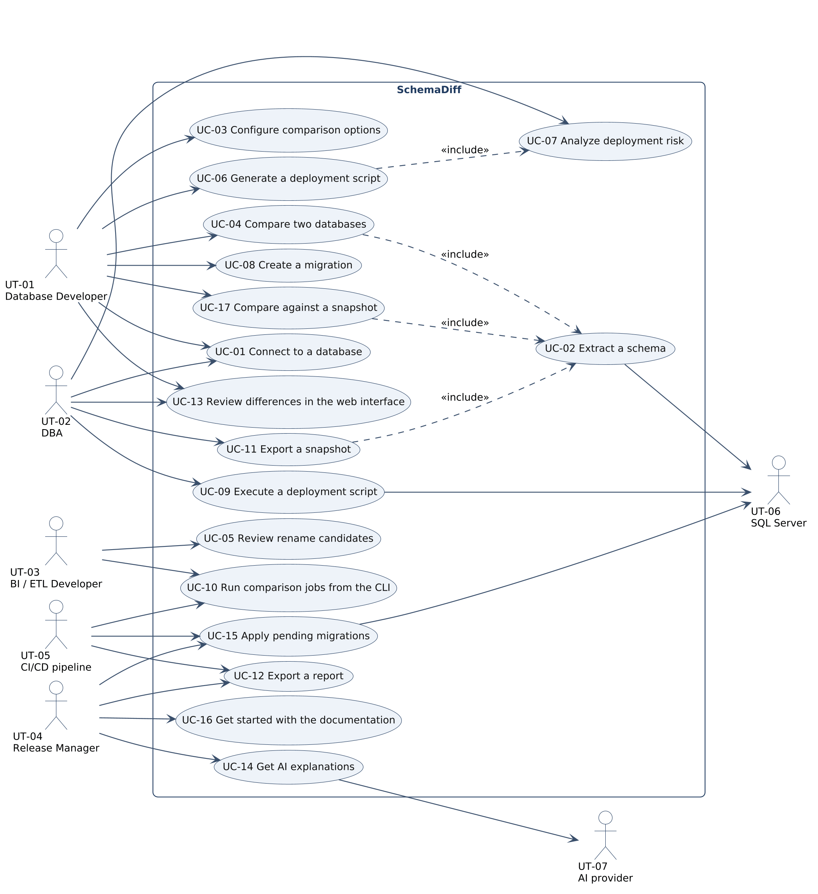

UT-01 to UT-05 start use cases, SQL Server (UT-06) and the AI provider (UT-07) are secondary. UC-04, UC-11 and
UC-17 include UC-02, and UC-06 includes UC-07 so safe mode always has a risk classification.

#### 3.3.2 Connection Management

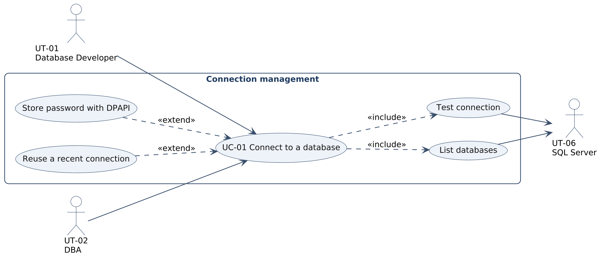

T-01, UC-01. Testing is included, recent connections and stored passwords extend it.

#### 3.3.3 Extraction and Comparison

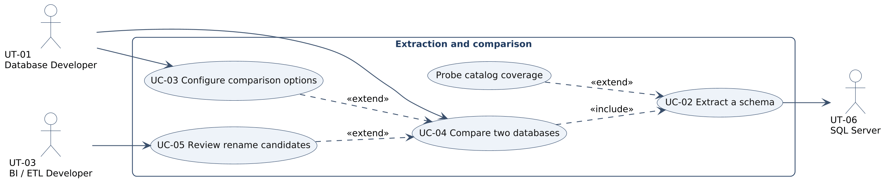

T-02 to T-05, UC-02 to UC-05. Comparing includes extraction, the other cases are optional.

#### 3.3.4 Deployment Script, Risk and Execution

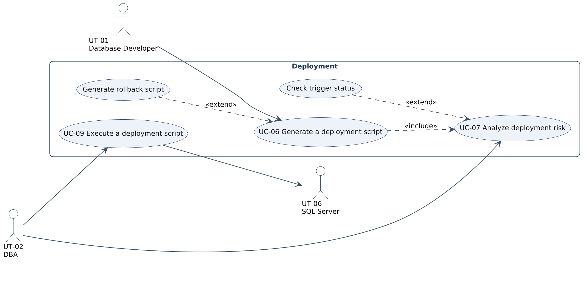

T-06, T-07, T-09, UC-06, UC-07, UC-09. Rollback and trigger report are optional.

#### 3.3.5 Migrations

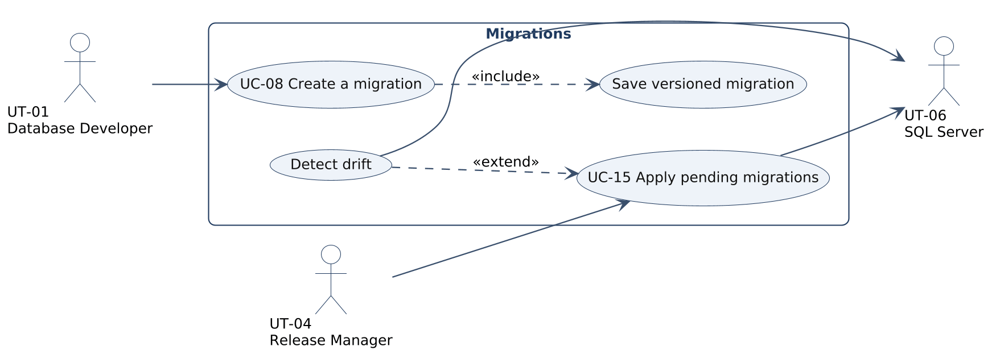

T-08, UC-08, UC-15. Applying and drift check use the history table.

#### 3.3.6 Command Line and Reports

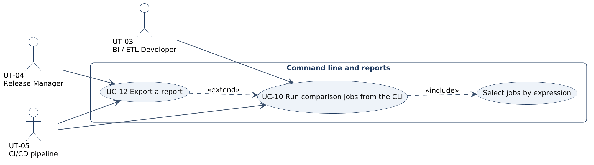

T-10, T-12, UC-10, UC-12. Every CLI run selects jobs.

#### 3.3.7 Snapshots

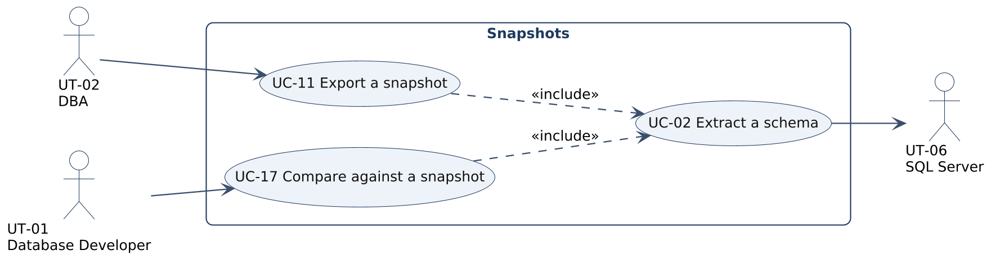

T-11, UC-11, UC-17. The DBA exports, the developer compares.

#### 3.3.8 Web Interface

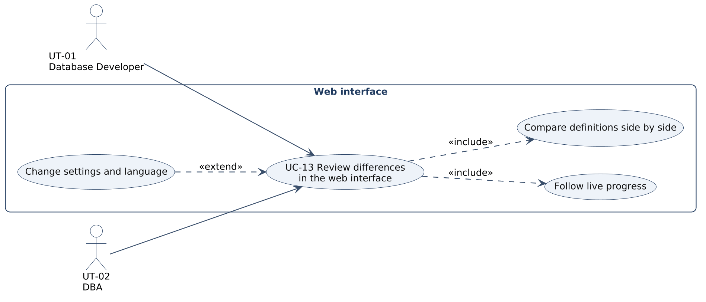

T-13, UC-13. Progress and side-by-side view are included, settings extend it.

#### 3.3.9 AI Assistant

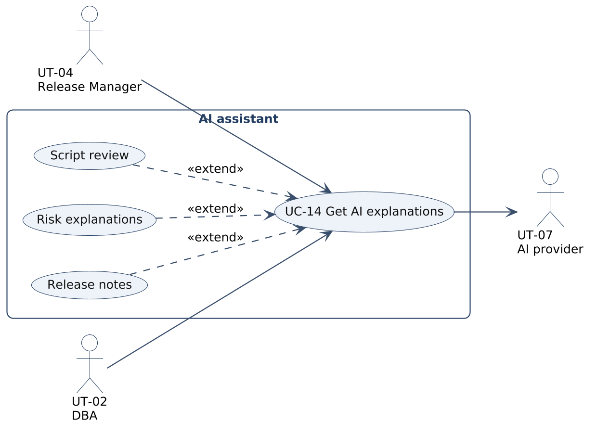

T-14, UC-14. Every request sends schema metadata only.

#### 3.3.10 Documentation

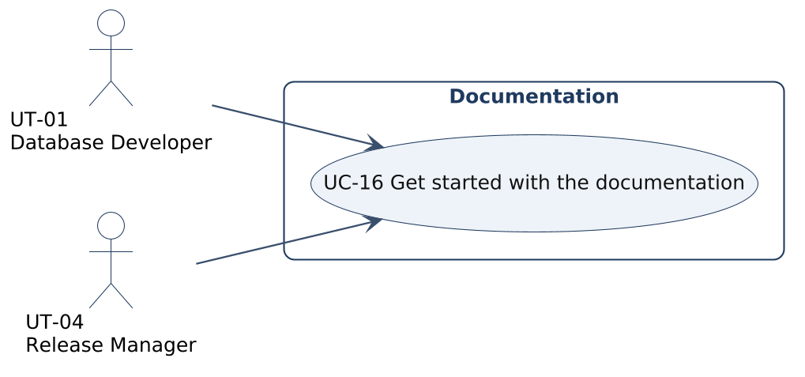

T-16, UC-16. T-15 is technical and has no use case.

### 3.4 Use Cases

#### 3.4.1 Use Case Coverage Matrix

| Project Plan task ID | Functional requirement ID(s) | Use case ID(s) | Scenario ID(s) |
|-----|----------|------|------|
| T-01 | FR-01 to FR-05 | UC-01 | SC-01 |
| T-02 | FR-06 to FR-10 | UC-02 | SC-01, SC-02 |
| T-03 | FR-11 to FR-13 | UC-03 | SC-01 |
| T-04 | FR-14 to FR-16 | UC-04 | SC-01 |
| T-05 | FR-17 | UC-05 | SC-08 |
| T-06 | FR-18 to FR-24 | UC-06 | SC-04 |
| T-07 | FR-25 to FR-28 | UC-07 | SC-02 |
| T-08 | FR-29 to FR-32 | UC-08, UC-15 | SC-06 |
| T-09 | FR-33 to FR-35 | UC-09 | SC-04 |
| T-10 | FR-36 to FR-40 | UC-10 | SC-03 |
| T-11 | FR-41, FR-42 | UC-11, UC-17 | SC-07 |
| T-12 | FR-43 | UC-12 | SC-03, SC-05 |
| T-13 | FR-44 to FR-47 | UC-13 | SC-01 |
| T-14 | FR-48 to FR-51 | UC-14 | SC-05 |
| T-15 | none (technical, see NFR-04, NFR-11) | none | SC-09 |
| T-16 | FR-55 | UC-16 | SC-10 |

All sixteen tasks are covered. In the use cases, A marks alternatives, E errors, and brackets the branching step.

#### 3.4.2 UC-01 Connect to a database

**Actors:** UT-01, UT-02, UT-06. **Task:** T-01. **Requirements:** FR-01 to FR-05  
**Goal:** a working connection. **Pre:** the user knows server and credentials.  
**Main flow:** 1. User enters server and credentials and tests. 2. System shows server details and databases. 3. User picks a database. 4. System saves the entry, protecting the password with DPAPI if asked.  
**Alternatives:** A1 (1) a recent entry fills the fields and its password stays on the server. A2 (1) forgetting
an entry deletes it.  
**Errors:** E1 (2) the first error line is shown. E2 (4) without DPAPI no password is stored.  
**Post:** no password exists in plain text.

#### 3.4.3 UC-02 Extract a schema

**Actors:** UT-01 to UT-03, UT-06. **Task:** T-02. **Requirements:** FR-06 to FR-10  
**Goal:** read a complete schema fast and safely. **Pre:** a valid connection (UC-01).  
**Main flow:** 1. User starts a comparison, export or probe. 2. System checks version and permissions. 3. System
runs one read-only query per class in parallel. 4. System normalizes, hashes and builds the reference graph and
the extraction report.  
**Alternatives:** A1 (2) the probe lists readable classes. A2 (3) a failed optional query becomes a warning.  
**Errors:** E1 (4) unreadable modules are indeterminate. E2 (3) a failed required query stops extraction.  
**Post:** the report names everything that was not read.

#### 3.4.4 UC-03 Configure comparison options

**Actors:** UT-01. **Task:** T-03. **Requirements:** FR-11 to FR-13  
**Goal:** decide which differences count. **Pre:** settings open or CLI options given.  
**Main flow:** 1. User opens the settings. 2. System shows the defaults. 3. User changes options. 4. System saves
them for the next comparisons.  
**Alternatives:** A1 (1) CLI options apply to one run.  
**Errors:** E1 (4) an untokenizable body is compared by whitespace only, never altered.  
**Post:** ignored differences give equal hashes and literals stay unchanged.

#### 3.4.5 UC-04 Compare two databases

**Actors:** UT-01, UT-02, UT-06. **Task:** T-04. **Requirements:** FR-14 to FR-16  
**Goal:** find every difference. **Pre:** source and target selected.  
**Main flow:** 1. User starts the comparison. 2. System extracts both sides (UC-02). 3. System matches objects by
schema, name and kind and compares hashes. 4. System shows the classified, grouped result with change trees.  
**Alternatives:** A1 (3) casing-only name differences count only with case-sensitive names. A2 (4) identical
databases offer no script.  
**Errors:** E1 (2) a failed side stops the run with its reason. E2 (4) unscriptable kinds are marked report only.  
**Post:** every difference and indeterminate object is listed.

#### 3.4.6 UC-05 Review rename candidates

**Actors:** UT-03. **Task:** T-05. **Requirements:** FR-17  
**Goal:** avoid losing data on a rename. **Pre:** removed and added items exist.  
**Main flow:** 1. System pairs removed and added items with equal structure hashes. 2. System lists them as
candidates. 3. User checks both definitions and writes any sp_rename outside the tool.  
**Alternatives:** A1 (3) a real drop and add stays two differences.  
**Errors:** E1 (2) several matches are all listed, none is chosen.  
**Post:** no sp_rename is generated.

#### 3.4.7 UC-06 Generate a deployment script

**Actors:** UT-01, UT-02. **Task:** T-06. **Requirements:** FR-18 to FR-24  
**Goal:** a script for selected objects. **Pre:** differences exist.  
**Main flow:** 1. User selects objects and requests the script. 2. System runs UC-07 and orders objects by
dependency. 3. System writes the statements, leaving data loss out in safe mode. 4. System wraps them in one
XACT_ABORT transaction and lists excluded steps.  
**Alternatives:** A1 (1) safe mode off includes marked data loss steps. A2 (4) a rollback script is added. A3 (1)
direction is set per object.  
**Errors:** E1 (2) a cycle keeps input order with a warning. E2 (3) unscriptable objects are listed as skipped.  
**Post:** only selected objects appear, in a safe order.

#### 3.4.8 UC-07 Analyze deployment risk

**Actors:** UT-02. **Task:** T-07. **Requirements:** FR-25 to FR-28  
**Goal:** know whether a table change blocks or loses data. **Pre:** changed tables and row counts.  
**Main flow:** 1. User opens the risk view. 2. System classifies each change as safe, in place, blocked if not
empty or data loss. 3. System combines it with the row count and marks blocking and conditional changes.  
**Alternatives:** A1 (1) the trigger report lists state differences.  
**Errors:** E1 (3) an unknown row count is treated as filled.  
**Post:** every risky change is shown with reason and row count.

#### 3.4.9 UC-08 Create a migration

**Actors:** UT-01. **Task:** T-08. **Requirements:** FR-29  
**Goal:** a repeatable, versioned change. **Pre:** a reviewed comparison and a migrations folder.  
**Main flow:** 1. User saves the comparison with a description. 2. System generates deployment and rollback
scripts (UC-06). 3. System writes `V###__description.sql` and its rollback with the next version.  
**Alternatives:** A1 (1) with nothing selected no file is written.  
**Errors:** E1 (3) an existing version file is named, never overwritten.  
**Post:** a new file pair exists.

#### 3.4.10 UC-09 Execute a deployment script

**Actors:** UT-02, UT-06. **Task:** T-09. **Requirements:** FR-33 to FR-35  
**Goal:** run a script and see what happened. **Pre:** a script (UC-06) and DDL rights.  
**Main flow:** 1. User confirms the run. 2. System splits at GO and runs the batches on one connection. 3. System
streams messages and batch progress. 4. System reports completion and time.  
**Alternatives:** A1 (3) result sets appear as a grid of up to 10,000 rows.  
**Errors:** E1 (2) a failed batch shows number, level, state and line, then rolls back. E2 (3) cancel rolls back.
E3 (2) a lost connection marks the run failed.  
**Post:** all batches ran or the transaction was rolled back.

#### 3.4.11 UC-10 Run comparison jobs from the CLI

**Actors:** UT-03, UT-05. **Task:** T-10. **Requirements:** FR-36 to FR-40  
**Goal:** compare many pairs in one command. **Pre:** a jobs.json with at least one job.  
**Main flow:** 1. Actor runs compare with an expression such as 1,3-5,EDWDM. 2. System validates jobs.json and
the selection. 3. System runs the jobs in parallel and prints each result. 4. System exits with 0, 1 or 2.  
**Alternatives:** A1 (1) without an expression the jobs are listed for selection. A2 (1) script and probe commands
work the same way.  
**Errors:** E1 (2) invalid configuration or selection exits with 2 and names the problem. E2 (3) a failed job
does not stop others.  
**Post:** the exit code reflects the outcome.

#### 3.4.12 UC-11 Export a snapshot

**Actors:** UT-02, UT-06. **Task:** T-11. **Requirements:** FR-41  
**Goal:** a schema file others can compare against. **Pre:** access to the reference database.  
**Main flow:** 1. User starts the export. 2. System extracts the schema (UC-02). 3. System writes a compressed file
with a version header and reports size and object count.  
**Alternatives:** A1 (1) a scheduled CLI export writes a new file each time.  
**Errors:** E1 (2) unreadable objects are stored as indeterminate.  
**Post:** the file can be used without the reference database.

#### 3.4.13 UC-12 Export a report

**Actors:** UT-04, UT-05. **Task:** T-12. **Requirements:** FR-43  
**Goal:** share results with people who do not run the tool. **Pre:** a comparison result.  
**Main flow:** 1. Actor requests an HTML or JSON report. 2. System writes a standalone report with counts,
differences and risks.  
**Alternatives:** A1 (1) a CLI option writes one report per job.  
**Errors:** E1 (2) a write failure names the path, the exit code is unchanged.  
**Post:** the report opens offline and matches the counts.

#### 3.4.14 UC-13 Review differences in the web interface

**Actors:** UT-01, UT-02. **Task:** T-13. **Requirements:** FR-44 to FR-47  
**Goal:** review a comparison as in SSDT. **Pre:** the backend runs on 127.0.0.1.  
**Main flow:** 1. User selects source and target and starts. 2. System streams progress over SSE. 3. System shows
the grouped tree with checkboxes. 4. User selects an object and the system shows both definitions side by side.  
**Alternatives:** A1 (1) a second tab runs its own session.  
**Errors:** E1 (2) closing the tab disposes the session. E2 (1) an unreachable backend is explained.  
**Post:** the objects for the next step are selected.

#### 3.4.15 UC-14 Get AI explanations

**Actors:** UT-04, UT-02, UT-07. **Task:** T-14. **Requirements:** FR-48 to FR-51  
**Goal:** plain language explanations. **Pre:** the assistant is enabled.  
**Main flow:** 1. User asks for release notes, risk explanations or a script review. 2. System builds a prompt from
metadata only. 3. System sends it to the provider, local by default. 4. System shows the parsed answer.  
**Alternatives:** A1 (3) a configured OpenAI-compatible provider is used instead.  
**Errors:** E1 (3) an unavailable provider is reported and all else works. E2 (4) unparsable text is shown as
unstructured.  
**Post:** no row data left the machine.

#### 3.4.16 UC-15 Apply pending migrations

**Actors:** UT-04, UT-05, UT-06. **Task:** T-08. **Requirements:** FR-30 to FR-32  
**Goal:** bring an environment to the latest version. **Pre:** migration files (UC-08) and target access.  
**Main flow:** 1. Actor lists pending migrations. 2. System reads `__SchemaDiffMigrations` and shows missing
versions. 3. Actor applies them. 4. System executes them in order (UC-09) and records version and checksum.  
**Alternatives:** A1 (1) the drift check lists live changes since the last migration.  
**Errors:** E1 (2) a checksum mismatch stops the run. E2 (4) a failed migration rolls back and stops the rest.  
**Post:** history matches the files.

#### 3.4.17 UC-16 Get started with the documentation

**Actors:** UT-04 or any new user. **Task:** T-16. **Requirements:** FR-55  
**Goal:** a first comparison without help. **Pre:** access to two databases.  
**Main flow:** 1. User installs the release from the README. 2. User fills the sample jobs.json. 3. User runs
compare as the CLI reference describes.  
**Alternatives:** A1 (1) the web guide walks through connect, compare and review.  
**Errors:** E1 (1) a missing prerequisite points to the prerequisites section.  
**Post:** the user ran a comparison from the documentation alone.

#### 3.4.18 UC-17 Compare against a snapshot

**Actors:** UT-01, UT-06. **Task:** T-11. **Requirements:** FR-42  
**Goal:** compare with an unreachable environment. **Pre:** a snapshot file (UC-11).  
**Main flow:** 1. User selects the file as target and a live source. 2. System checks the version header.
3. System extracts the source (UC-02) and compares (UC-04).  
**Alternatives:** A1 (1) the snapshot can also be the source.  
**Errors:** E1 (2) an unsupported version is refused.  
**Post:** the result equals a live comparison at export time.

<!-- pagebreak -->

## 4. User Interface Model

Eight screens cover the web workflow from connect to execution. The PlantUML Salt mock-ups follow the planned
web interface, which mirrors SSDT Schema Compare (NFR-06). Names are fixture examples. The CLI (UC-10) has no screens.

| Screen ID | Screen name | User story ID(s) | Project Plan component(s) | Related requirement or use case ID(s) |
|-----|--------|--------|--------------|--------------|
| UI-01 | Connect dialog | US-01, US-02, US-03 | Connect dialog WBS-1.3, credential store WBS-1.2 | FR-01 to FR-05, UC-01 |
| UI-02 | Compare start | US-27, US-29, US-30 | Compare view WBS-13.2, snapshots WBS-11.1 | FR-42, FR-44, UC-04, UC-17 |
| UI-03 | Comparison progress | US-05, US-06, US-29 | SSE backend WBS-13.1, extraction runner WBS-2.3 | FR-09, FR-44, NFR-05, UC-02 |
| UI-04 | Result tree and definitions | US-10, US-11, US-13, US-30 | Compare view WBS-13.2, diff engine WBS-4.1, WBS-4.2, renames WBS-5.1 | FR-14, FR-15, FR-17, FR-45, UC-04, UC-05, UC-13 |
| UI-05 | Deployment risk view | US-19, US-20, US-31 | Risk view WBS-13.3, analyzer WBS-7.1, triggers WBS-7.2 | FR-25 to FR-28, UC-07 |
| UI-06 | Generated script | US-14, US-17, US-18, US-21 | Safe mode WBS-6.4, rollback WBS-6.5, migrations WBS-8.1 | FR-18 to FR-24, FR-29, UC-06, UC-08 |
| UI-07 | Execution messages | US-23, US-24 | Execution UI WBS-9.2, engine WBS-9.1 | FR-33 to FR-35, UC-09 |
| UI-08 | Comparison options and language | US-08, US-31 | Settings WBS-13.3, normalizer WBS-3.1 | FR-11, FR-13, FR-46, UC-03 |

### 4.1 UI-01 Connect dialog

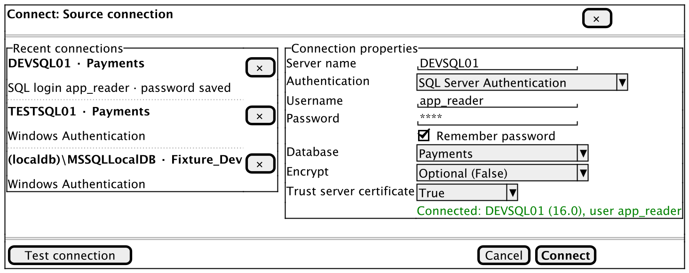

Opened from Source or Target. Recent connections are on the left, a saved password is only flagged, never sent
back. The right side holds the SSDT connection properties. Test connection shows server, version and login or the
first error line. Connect returns to UI-02.

### 4.2 UI-02 Compare start

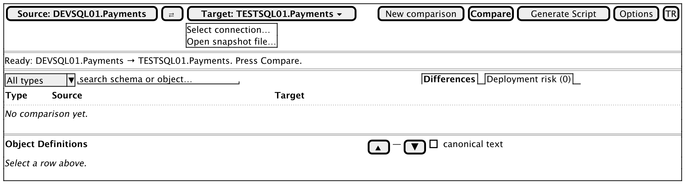

The main window before a comparison. The top bar holds the source and target selectors with a swap button. The
target menu offers a live connection or a snapshot file (UC-17). Compare is enabled once both sides are set, and
New comparison opens a separate tab with its own session (FR-47). Options and the TR language switch open UI-08.

### 4.3 UI-03 Comparison progress

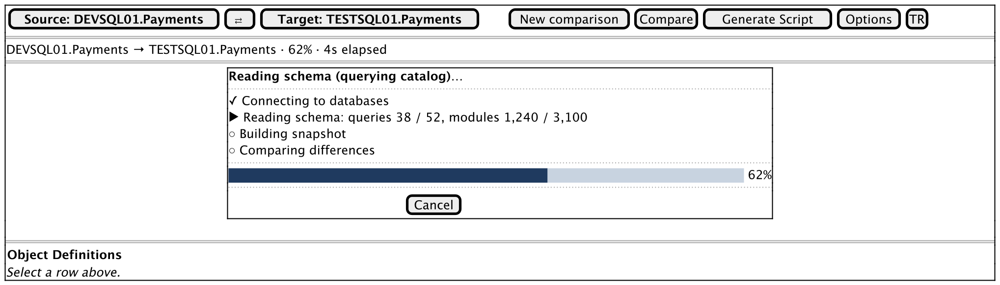

While a comparison runs, a card shows the phase, query and module counters, percentage and elapsed time over SSE
(NFR-05). Cancel returns to UI-02. On success UI-04 appears.

### 4.4 UI-04 Result tree and definitions

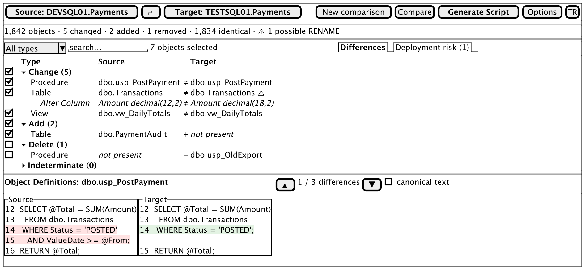

The upper pane groups differences by Change, Add, Delete and Indeterminate. Checkboxes choose what Generate Script
includes, sub-change rows such as Alter Column come from the change tree, a warning sign links to UI-05 and the
status line reports rename candidates. The lower pane shows both definitions side by side with difference arrows.
