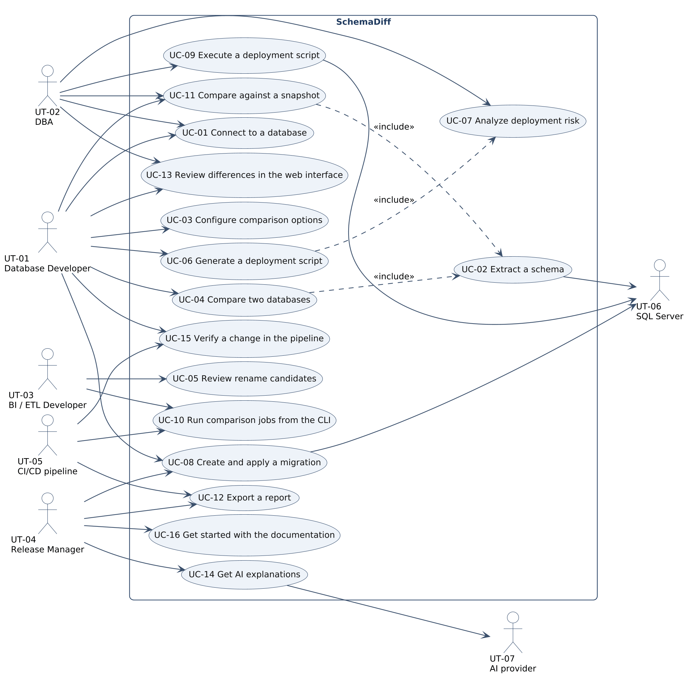

# Requirements Specification: SchemaDiff

## Cover Page

| Field | Details |
|---|---|
| **Course** | BLG 411E Software Engineering (2026–2027 Fall Term) |
| **Report name** | Requirements Specification |
| **Project title** | SchemaDiff: Fast SQL Server Schema Comparison, Deployment & Migration Tool |
| **Group name / number** | SegFault |
| **Group members** | Mehmet Elhan — 150220013, Ömer Faruk Yılmaz — 150220057, Mücahit Günay — 150220027, İsmail Yeşilyurt — 150220009, Mustafa Talha Yıldırım — 150220008, Enes Birol Tatlı — 150230713 |
| **Product Owner** | İsmail Yeşilyurt (150220009) |
| **Instructors** | Prof. Dr. Tolga Ovatman, Assoc. Prof. Dr. Ayşe Tosun |
| **Submission date** | 2026-11-06 |
| **Document version** | 1.0 |

---

## 1. Introduction

SchemaDiff answers the question "what changed between two SQL Server databases?" and turns the answer into
a safe, ordered deployment script. Teams that run several environments of the same databases (development,
test, production, and the staging, core and mart layers of a data warehouse) need this answer before every
release. Existing tools such as SSDT Schema Compare build a full semantic model and can take minutes on
databases with 10,000+ objects. SchemaDiff reads the system catalog in bulk, normalizes T-SQL on the ScriptDom
token stream and compares objects by XxHash128 hashes. On top of the comparison it analyzes deployment risk,
generates deployment and rollback scripts, keeps versioned migrations and offers an optional AI assistant
that explains changes in plain language. It is used from a CI-friendly command line tool and a local web
interface.

This document specifies what the system must do. It refines the tasks of the Project Plan (T-01 to T-16)
and the deliverables (D-01 to D-07) into requirements and use cases, and keeps every identifier consistent
with the plan so each requirement can be traced to a task, a deliverable and the WBS activities that
implement it.

- **Section 2** lists the functional requirements (FR) with their task, deliverable, priority and acceptance
  condition, followed by the non-functional requirements (NFR) with how each one is measured.
- **Section 3** describes the users: user types, personas and scenarios, and a user story for every WBS
  activity of the plan. It then shows the use case diagrams for the whole system and for each major
  functionality, a coverage matrix from tasks to use cases, and a detailed use case for every task with
  main, alternative and error flows.
- **Section 4** records the changes to the Project Plan since version 1.0, as requested for this deliverable.

Priorities follow MoSCoW: **Must** is required for the final release, **Should** is planned and expected,
**Could** is delivered if the critical path keeps its schedule.

---

## 2. System Requirements

### 2.1 Functional Requirements

Each requirement is written as an observable behavior and linked to the task(s) and deliverable(s) of the
Project Plan.

| Requirement ID | Related task ID(s) | Related deliverable ID(s) | Functional requirement (natural language) | Priority | Verification / acceptance condition |
|---|---|---|---|---|---|
| FR-06 | T-02 | D-01 | The system shall read the schema with one read-only catalog query per object class, running the queries on parallel connections under a global concurrency limit. | Must | Query tests prove every query is read-only and reads only sys views. Gate tests prove the limit is never exceeded. |
| FR-07 | T-02 | D-01 | The system shall continue the comparison when an optional catalog query fails because of an older server version or a missing permission, and shall name the failed query in the extraction report. | Must | Fault injection test makes an optional query fail and the comparison still completes with a warning that names it. |
| FR-08 | T-02 | D-01 | The system shall detect missing VIEW DEFINITION permission and report the affected modules as uncertain, never as equal. | Must | A low privilege fixture login yields uncertain modules and a warning. No uncertain object is counted as equal. |
| FR-09 | T-02 | D-01, D-04 | The system shall report extraction progress as the number of finished and total queries and normalized modules while a comparison runs. | Should | Progress tests check counters, phases that only move forward and percentage bands. |
| FR-10 | T-02 | D-01, D-03 | The system shall provide a coverage probe that lists, for every object class, whether it can be read with the current permissions. | Should | Probe output on a low privilege login marks the unreadable classes. Probe queries are read-only. |
| FR-11 | T-03 | D-01 | The system shall normalize module bodies on the T-SQL token stream with options to ignore whitespace, comments, semicolons, keyword casing and identifier quoting, and shall never change string literals. | Must | Golden file tests and an option matrix where each pair differs in one dimension only. |
| FR-12 | T-03 | D-01 | The system shall compute an XxHash128 hash for every object and for each of its sub-parts (columns, indexes, constraints, foreign keys, body, permissions). | Must | Hash tests prove determinism and that changing one part only changes that part hash. |
| FR-13 | T-03 | D-01, D-04 | The system shall apply the comparison options chosen by the user: ignore column order, collation, identity seed and increment, fill factor, padding, data compression, system named constraints, and case sensitive object and column names. | Must | Builder tests show that an ignored difference produces the same hash and a respected one does not. |
| FR-14 | T-04 | D-01 | The system shall classify every object as added, removed, changed, equal or indeterminate by comparing source and target hashes. | Must | Comparing the dev and prod fixtures returns exactly the differences in tests/fixtures/expected.md. |
| FR-15 | T-04 | D-01, D-04 | The system shall show the changed sub-parts of a changed object as a change tree (for example Add Column, Alter Column, Drop Index). | Must | Change tree tests for every sub-change kind on fixture pairs. |
| FR-16 | T-04 | D-01 | The system shall compare every object kind listed in the charter scope, and shall report explicitly any kind it cannot script. | Must | Coverage matrix test: every object kind is either scripted or listed as report only. |
| FR-17 | T-05 | D-01 | The system shall detect a removed and an added object with identical structure and report them as a rename candidate, without generating sp_rename. | Should | Rename tests on fixture pairs. No sp_rename appears in generated scripts for candidates. |
| FR-18 | T-06 | D-02 | The system shall generate a deployment script in dependency order (types, tables, modules, security, permissions, settings) in which every object is created after the objects it references. | Must | Ordering tests on the reference graph. Every generated fixture script runs without a missing object error. |
| FR-19 | T-06 | D-02 | The system shall turn the CREATE statement of an existing module into ALTER at token level, keeping the original body. | Must | Token level tests with comments and strings around the CREATE keyword. |
| FR-20 | T-06 | D-02 | The system shall wrap the generated script in a single transaction with XACT_ABORT ON so that a failing step leaves the target unchanged. | Must | A script with a failing step leaves the fixture target identical to its state before the run. |
| FR-21 | T-06 | D-02, D-04 | The system shall run in safe mode by default, leaving data loss steps out of the script and listing them separately. | Must | A column drop on a filled table is not in the safe mode script and is listed as excluded. |
| FR-22 | T-06 | D-02, D-04 | The system shall generate the script only for the objects the user selected. | Must | Selection tests: unselected objects never appear in the script. |
| FR-23 | T-06 | D-02 | The system shall generate a rollback script that restores the original target schema. | Should | Apply then rollback on fixtures restores the original schema hash. |
| FR-24 | T-06 | D-02 | The system shall generate a mixed direction script in which the direction (source to target or target to source) is chosen per object. | Could | Bidirectional tests on fixture pairs. |
| FR-41 | T-11 | D-01, D-03 | The system shall export a database snapshot to a compressed file with a version header. | Should | Round trip test: an imported snapshot equals the live extraction. |
| FR-42 | T-11 | D-01, D-03, D-04 | The system shall compare a live database against a snapshot file without access to the database the snapshot came from. | Should | Comparing a fixture with its own snapshot reports no differences. |

### 2.2 Non-functional Requirements

| Requirement ID | Quality attribute | Non-functional requirement (natural language) | Applies to | Verification / measurement |
|---|---|---|---|---|

---

## 3. Use Cases

### 3.1 User Types

| User type ID | User type / actor | Description and responsibilities | Goals / typical actions | Related requirement ID(s) |
|---|---|---|---|---|
| UT-01 | Database Developer | Writes tables, views, procedures and functions in a development database and prepares them for release. | Compare dev with test, review differences, generate a script for selected objects, save a migration. | FR-01 to FR-24, FR-29, FR-44 to FR-46 |
| UT-02 | Database Administrator (DBA) | Owns the test and production servers and approves what is deployed there. | Check deployment risk, run scripts in a transaction, compare production with a snapshot, check trigger states. | FR-08, FR-21, FR-25 to FR-28, FR-33 to FR-35, FR-42 |
| UT-03 | BI / ETL Developer | Maintains the staging, core and mart layers of a data warehouse. | Compare all layers at once from the CLI, find renamed columns, keep layers in sync. | FR-17, FR-36 to FR-40 |
| UT-04 | Release Manager | Plans and documents releases across environments. | Get release notes and HTML reports, follow pending migrations and drift. | FR-31, FR-32, FR-43, FR-48 |
| UT-05 | CI/CD pipeline (external system) | Runs SchemaDiff from the command line in automated jobs. | Detect schema drift through exit codes, publish reports as build artifacts. | FR-36 to FR-40, FR-43, FR-53 |
| UT-06 | SQL Server instance (external system) | Source or target of a comparison and target of script execution. | Answers catalog queries, executes scripts and stores the migration history. | FR-06 to FR-10, FR-30, FR-33 |
| UT-07 | AI provider (external system) | Local Ollama model by default, optionally an OpenAI-compatible service. | Turns schema metadata into summaries, explanations and review comments. | FR-48 to FR-51 |

**Access or role distinctions:**

The tool runs locally and has no accounts of its own. What a user can do depends on the SQL Server permissions
of the login used for the connection. Comparison needs VIEW DEFINITION and, for row counts, VIEW DATABASE STATE.
Script execution and migration apply need DDL permissions on the target and are therefore usually done by a
DBA (UT-02). Developers (UT-01, UT-03) typically have full rights on development and read-only rights on
production, which is why comparing against a snapshot (FR-42) matters for them.

#### Personas

| Persona ID | Name | User type | Background | Main need |
|---|---|---|---|---|
| P-01 | Elif, 29 | UT-01 | Database developer in the core banking team, writes stored procedures every day and releases every two weeks. | See exactly what she changed since the last release and get a script for only her objects. |
| P-02 | Murat, 41 | UT-02 | Senior DBA responsible for the production servers, signs off every deployment. | Know before running a script whether it will be blocked or lose data. |
| P-03 | Deniz, 34 | UT-03 | Data warehouse engineer maintaining seven layered databases. | Compare all layers in one run every night and get notified only when something differs. |
| P-04 | Selin, 38 | UT-04 | Release manager coordinating three teams. | Readable release notes and a report she can attach to the change request. |

### 3.2 User Scenarios

#### User Stories Linked to the Project Plan

Every WBS activity of the Project Plan has a user story, or an explanation when the activity is purely technical.

| Scenario ID | Project Plan WBS activity ID | User story | Related requirement ID(s) |
|---|---|---|---|
| SC-01 | WBS-2.1 | Technical activity: the shared domain model and module contracts. It has no direct user story and enables every story of T-02 to T-14. | FR-06, FR-14 |
| SC-01 | WBS-2.2 | As a database developer, I want the schema of a large database read in seconds, so that comparing before every release is not a burden. | FR-06 |
| SC-03 | WBS-2.3 | As a BI developer, I want extraction to run in parallel without overloading the server, so that comparing many layers at once stays safe. | FR-06, FR-09 |
| SC-02 | WBS-2.4 | As a DBA, I want objects I cannot read to be reported as uncertain and a probe that shows what my login can read, so that missing permissions never look like equal objects. | FR-07, FR-08, FR-10 |
| SC-01 | WBS-3.1 | As a database developer, I want formatting and comment changes to be ignored, so that only real changes appear in the result. | FR-11 |
| SC-01 | WBS-3.2 | Technical activity: hashing of objects and sub-parts. It has no direct user story and makes the comparison of FR-14 fast and the change tree of FR-15 possible. | FR-12 |
| SC-01 | WBS-4.1 | As a database developer, I want every object classified as added, removed or changed, so that I see the full difference at a glance. | FR-13, FR-14 |
| SC-01 | WBS-4.2 | As a database developer, I want to drill down from a changed table to the columns and indexes that changed, so that I understand the change without reading the whole definition. | FR-15 |
| SC-02 | WBS-4.3 | As a DBA, I want every object kind I use (indexes, permissions, partitions, extended properties and more) compared, so that nothing is deployed by surprise. | FR-16 |
| SC-08 | WBS-5.1 | As a BI developer, I want a renamed column recognized as a rename candidate, so that I do not drop a column full of data by mistake. | FR-17 |
| SC-04 | WBS-6.1 | As a DBA, I want the script to create objects in dependency order, so that it never fails on a missing object. | FR-18 |
| SC-04 | WBS-6.2 | As a DBA, I want table, index, constraint and type changes scripted correctly, so that I can deploy them without writing DDL by hand. | FR-18, FR-22 |
| SC-04 | WBS-6.3 | As a database developer, I want changed procedures, views, functions, roles and permissions scripted with ALTER where possible, so that dependent objects and permissions are kept. | FR-19 |
| SC-04 | WBS-6.4 | As a DBA, I want the script in one transaction, data loss steps left out by default and only my selected objects included, so that a deployment is all or nothing and never destroys data unasked. | FR-20, FR-21, FR-22 |
| SC-04 | WBS-6.5 | As a DBA, I want a rollback script and per object direction, so that I can undo a deployment or copy a fix back to development. | FR-23, FR-24 |
| SC-07 | WBS-11.1 | As a database developer without production access, I want to compare against a production snapshot, so that I see what production will receive. | FR-41, FR-42 |

<!-- pagebreak -->

### 3.3 Use Case Diagrams

Use case names, actors and identifiers match Section 2 and Section 3.4. The diagrams use UML use case
notation and were drawn with PlantUML. Their sources are kept next to the images in
`docs/diagrams/requirements`, so they can be updated together with this document.

#### 3.3.1 Whole-System Use Case Diagram

### 3.4 Use Cases

Every task of the Project Plan has at least one detailed use case below.

#### 3.4.3 UC-02 — Extract a schema

| Field | Description |
|---|---|
| **Use case ID** | UC-02 |
| **Use case name** | Extract a schema |
| **Goal / Purpose** | Read the complete schema of a database quickly and safely so it can be compared. |
| **Actor(s)** | System, started by UC-04 or UC-11 on behalf of UT-01 to UT-03. UT-06 SQL Server (secondary). |
| **Related Project Plan task(s)** | T-02 |
| **Related functional requirement(s)** | FR-06 to FR-10 |

**Pre-condition(s):**
A valid connection exists (UC-01). The login has at least VIEW DEFINITION for a complete result.

**Main success flow:**

1. **System:** Runs a preflight query for the server name, database, version and VIEW DEFINITION permission.
2. **System:** Queues one read-only query per object class and reports the total to the progress counter.
3. **System:** Runs the queries on parallel connections without exceeding the global concurrency limit.
4. **System:** Normalizes module bodies and builds the canonical text and hashes of every object.
5. **System:** Builds the reference graph from module dependencies and foreign keys.
6. **System:** Returns the snapshot together with an extraction report of timings, row counts and warnings.

**Alternative flows:**

- **A1 — Coverage probe first (branches from step 1):**
  1. The actor runs the probe command before the comparison.
  2. The system lists for each object class whether it can be read with the current permissions.
  3. The actor fixes permissions or accepts the report and the flow continues at step 1.
- **A2 — Optional query fails (branches from step 3):**
  1. A query that needs a newer version or an extra permission fails.
  2. The system records its name in the failed queries and adds a warning.
  3. The flow continues with the remaining queries.

**Exception / error flows:**

- **E1 — Definitions not readable (occurs at step 4):** Modules with a NULL definition are marked indeterminate with a reason and a warning names the missing permission. They are never reported as equal.
- **E2 — Required query fails (occurs at step 3):** The extraction stops with an error that names the query. The comparison is not shown, because a partial schema would produce false differences.

**Post-condition(s):**
A snapshot of every readable object exists with hashes per object and per part, and the report says exactly what could not be read.

#### 3.4.4 UC-03 — Configure comparison options

| Field | Description |
|---|---|
| **Use case ID** | UC-03 |
| **Use case name** | Configure comparison options |
| **Goal / Purpose** | Decide which differences count, so the result shows only what matters to the team. |
| **Actor(s)** | UT-01 Database Developer (primary). |
| **Related Project Plan task(s)** | T-03 |
| **Related functional requirement(s)** | FR-11 to FR-13 |

**Pre-condition(s):**
The user has opened the settings panel or passes options on the command line.

**Main success flow:**

1. **Actor:** Opens the comparison settings.
2. **System:** Shows the options with their defaults: ignore whitespace and comments on, ignore system named constraints on, the rest off.
3. **Actor:** Changes options, for example ignores collation and column order.
4. **System:** Saves the options for the next comparisons.
5. **Actor:** Starts a comparison (UC-04).
6. **System:** Normalizes and hashes every object with the chosen options, so ignored differences produce the same hash.

**Alternative flows:**

- **A1 — Options from the command line (branches from step 1):**
  1. The actor passes options to the compare command.
  2. The system applies them for this run only.
  3. The flow continues at step 6.

**Exception / error flows:**

- **E1 — Body cannot be tokenized (occurs at step 6):** For a body that ScriptDom cannot tokenize the system falls back to whitespace normalization and never changes the text, so a difference is shown rather than hidden.

**Post-condition(s):**
The comparison uses the selected options, and string literals in module bodies are never altered by normalization.

#### 3.4.5 UC-04 — Compare two databases

| Field | Description |
|---|---|
| **Use case ID** | UC-04 |
| **Use case name** | Compare two databases |
| **Goal / Purpose** | Find every difference between a source and a target database. |
| **Actor(s)** | UT-01 Database Developer, UT-02 DBA (primary). UT-06 SQL Server (secondary). |
| **Related Project Plan task(s)** | T-04 |
| **Related functional requirement(s)** | FR-14 to FR-16 |

**Pre-condition(s):**
Source and target connections are selected (UC-01).

**Main success flow:**

1. **Actor:** Starts the comparison.
2. **System:** Extracts both schemas in parallel (UC-02) and reports progress.
3. **System:** Matches objects by schema, name and kind and compares their hashes.
4. **System:** Classifies each object as added, removed, changed, equal or indeterminate.
5. **System:** For changed objects lists the changed parts as a change tree.
6. **System:** Shows the counts and the grouped result.

**Alternative flows:**

- **A1 — Only casing differs (branches from step 3):**
  1. An object name differs only in casing.
  2. With case-insensitive names the system treats it as the same object and does not list it. With case-sensitive names it reports one change.
  3. The flow continues at step 4.
- **A2 — No differences (branches from step 6):**
  1. All objects are equal.
  2. The system reports that the databases are identical and offers no script.

**Exception / error flows:**

- **E1 — One side cannot be extracted (occurs at step 2):** The system stops the comparison, names the side and the reason, and keeps the other snapshot discarded so no partial result is shown.
- **E2 — Object kind not supported for scripting (occurs at step 5):** The difference is still listed and marked as report only, so it is never silently ignored.

**Post-condition(s):**
The user sees every difference, and every indeterminate object is listed with its reason.

#### 3.4.6 UC-05 — Review rename candidates

| Field | Description |
|---|---|
| **Use case ID** | UC-05 |
| **Use case name** | Review rename candidates |
| **Goal / Purpose** | Avoid losing data when an object or column was renamed instead of dropped and recreated. |
| **Actor(s)** | UT-03 BI / ETL Developer (primary). |
| **Related Project Plan task(s)** | T-05 |
| **Related functional requirement(s)** | FR-17 |

**Pre-condition(s):**
A comparison (UC-04) contains at least one removed and one added object or column.

**Main success flow:**

1. **System:** Finds removed and added pairs whose structure hashes are identical.
2. **System:** Lists them as rename candidates next to the normal differences.
3. **Actor:** Opens a candidate and compares the two definitions.
4. **Actor:** Confirms the rename and writes the sp_rename call, or rejects the candidate.
5. **System:** Keeps the candidate out of the drop and create steps of the safe mode script.

**Alternative flows:**

- **A1 — Candidate rejected (branches from step 4):**
  1. The actor decides it is a real drop and add.
  2. The system treats the pair as normal differences, the drop stays subject to the risk rules.

**Exception / error flows:**

- **E1 — Several possible pairs (occurs at step 2):** When one removed object matches several added ones, the system lists every pair and does not choose, so the user decides.

**Post-condition(s):**
Renames are visible and no rename candidate is scripted as a drop without the user's decision.

#### 3.4.7 UC-06 — Generate a deployment script

| Field | Description |
|---|---|
| **Use case ID** | UC-06 |
| **Use case name** | Generate a deployment script |
| **Goal / Purpose** | Get a script that brings the target in line with the source for the selected objects. |
| **Actor(s)** | UT-01 Database Developer, UT-02 DBA (primary). |
| **Related Project Plan task(s)** | T-06 |
| **Related functional requirement(s)** | FR-18 to FR-24 |

**Pre-condition(s):**
A comparison with differences exists (UC-04).

**Main success flow:**

1. **Actor:** Selects the objects to deploy in the result tree.
2. **Actor:** Requests the deployment script.
3. **System:** Runs the risk analysis (UC-07) for the selected table changes.
4. **System:** Orders the objects by dependency and section: types, tables, modules, security, permissions, settings.
5. **System:** Writes CREATE for new objects, ALTER for changed modules and the table changes, leaving data loss steps out in safe mode.
6. **System:** Wraps the script in a single transaction with XACT_ABORT ON and lists excluded steps in a header.
7. **Actor:** Reviews, copies or saves the script, or executes it (UC-09).

**Alternative flows:**

- **A1 — Data loss allowed (branches from step 2):**
  1. The actor turns safe mode off and confirms.
  2. The system includes the data loss steps and marks them in the script.
  3. The flow continues at step 4.
- **A2 — Rollback script (branches from step 7):**
  1. The actor asks for a rollback script.
  2. The system generates the inverse script that restores the target schema.
- **A3 — Mixed direction (branches from step 1):**
  1. The actor sets the direction per object.
  2. The system writes source to target and target to source changes in separate sections.

**Exception / error flows:**

- **E1 — Dependency cycle (occurs at step 4):** The system orders the objects in the cycle by name, writes a warning at the top of the script and lists the objects involved.
- **E2 — Object kind cannot be scripted (occurs at step 5):** The object is listed as skipped with the reason and is not silently dropped from the script.

**Post-condition(s):**
A script exists that contains only the selected objects in a safe order, with every excluded or skipped step listed.

#### 3.4.12 UC-11 — Compare against a snapshot

| Field | Description |
|---|---|
| **Use case ID** | UC-11 |
| **Use case name** | Compare against a snapshot |
| **Goal / Purpose** | Compare with an environment that cannot be accessed directly. |
| **Actor(s)** | UT-02 DBA (exports), UT-01 Database Developer (compares). |
| **Related Project Plan task(s)** | T-11 |
| **Related functional requirement(s)** | FR-41, FR-42 |

**Pre-condition(s):**
The DBA can connect to the reference database. The developer can connect to the database to compare.

**Main success flow:**

1. **Actor:** The DBA exports a snapshot of the reference database.
2. **System:** Extracts the schema (UC-02) and writes a compressed file with a version header.
3. **Actor:** The developer selects the snapshot file as the target and a live database as the source.
4. **System:** Loads the snapshot, extracts the live database and compares them (UC-04).

**Alternative flows:**

- **A1 — Snapshot from the CLI (branches from step 1):**
  1. The DBA runs the export command in a scheduled job.
  2. The system writes a new snapshot file every time.

**Exception / error flows:**

- **E1 — Incompatible snapshot version (occurs at step 4):** The system refuses the file and names the version it supports, instead of comparing against data it may misread.

**Post-condition(s):**
The comparison result is the same as comparing with the live reference database at the time of the export.

---

## 4. Changelog
