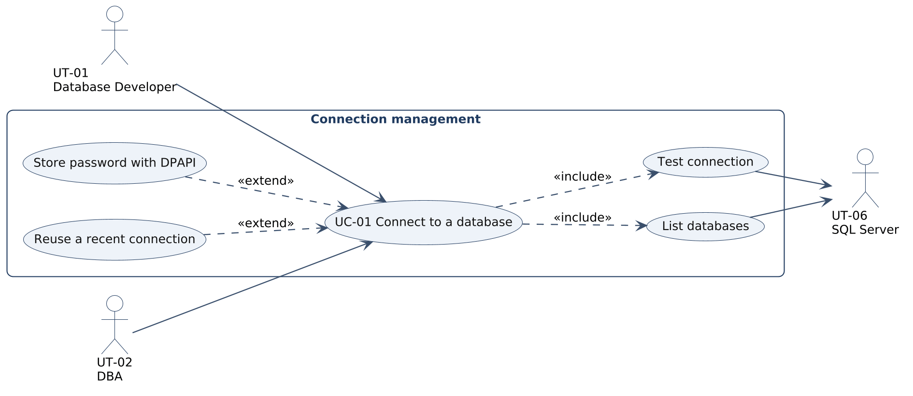
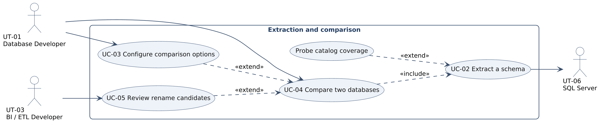
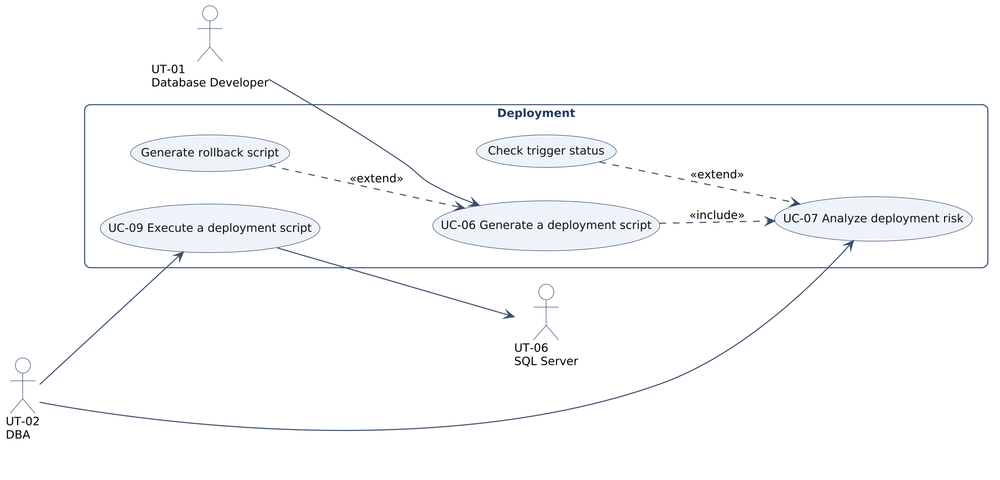
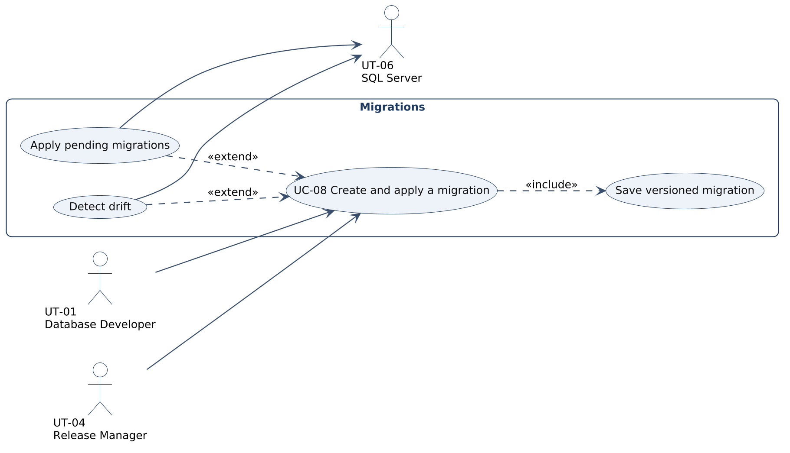
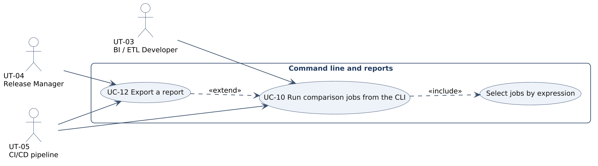
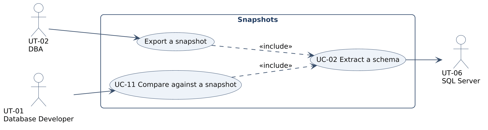
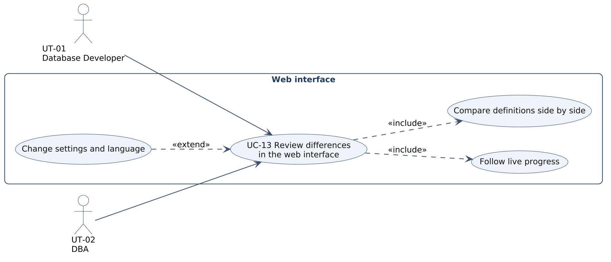
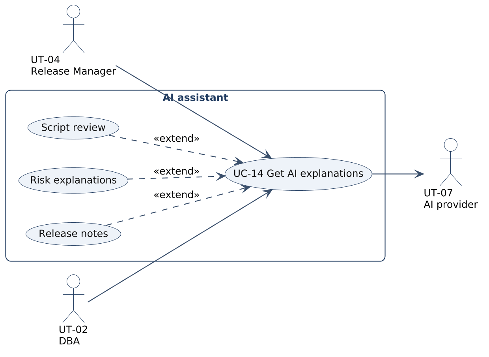
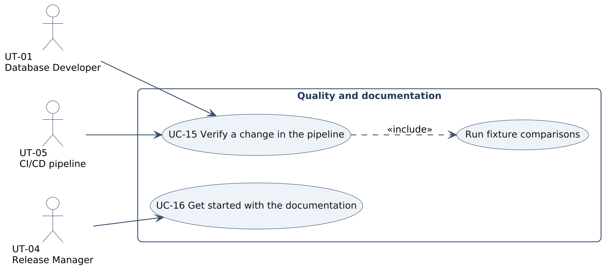

# Requirements Specification: SchemaDiff

## Cover Page

| Field | Details |
|---|---|
| **Course** | BLG 411E Software Engineering (2026–2027 Fall Term) |
| **Report name** | Requirements Specification |
| **Project title** | SchemaDiff: Fast SQL Server Schema Comparison, Deployment & Migration Tool |
| **Group name / number** | SegFault |
| **Group members** | Mehmet Elhan — 150220013, Ömer Faruk Yılmaz — 150220057, Mücahit Günay — 150220027, İsmail Yeşilyurt — 150220009, Mustafa Talha Yıldırım — 150220008, Enes Birol Tatlı — 150230713 |
| **Product Owner** | İsmail Yeşilyurt (150220009) |
| **Instructors** | Prof. Dr. Tolga Ovatman, Assoc. Prof. Dr. Ayşe Tosun |
| **Submission date** | 2026-11-06 |
| **Document version** | 1.0 |

---

## 1. Introduction

SchemaDiff answers the question "what changed between two SQL Server databases?" and turns the answer into
a safe, ordered deployment script. Teams that run several environments of the same databases (development,
test, production, and the staging, core and mart layers of a data warehouse) need this answer before every
release. Existing tools such as SSDT Schema Compare build a full semantic model and can take minutes on
databases with 10,000+ objects. SchemaDiff reads the system catalog in bulk, normalizes T-SQL on the ScriptDom
token stream and compares objects by XxHash128 hashes. On top of the comparison it analyzes deployment risk,
generates deployment and rollback scripts, keeps versioned migrations and offers an optional AI assistant
that explains changes in plain language. It is used from a CI-friendly command line tool and a local web
interface.

This document specifies what the system must do. It refines the tasks of the Project Plan (T-01 to T-16)
and the deliverables (D-01 to D-07) into requirements and use cases, and keeps every identifier consistent
with the plan so each requirement can be traced to a task, a deliverable and the WBS activities that
implement it.

- **Section 2** lists the functional requirements (FR) with their task, deliverable, priority and acceptance
  condition, followed by the non-functional requirements (NFR) with how each one is measured.
- **Section 3** describes the users: user types, personas and scenarios, and a user story for every WBS
  activity of the plan. It then shows the use case diagrams for the whole system and for each major
  functionality, a coverage matrix from tasks to use cases, and a detailed use case for every task with
  main, alternative and error flows.
- **Section 4** records the changes to the Project Plan since version 1.0, as requested for this deliverable.

Priorities follow MoSCoW: **Must** is required for the final release, **Should** is planned and expected,
**Could** is delivered if the critical path keeps its schedule.

---

## 2. System Requirements

### 2.1 Functional Requirements

Each requirement is written as an observable behavior and linked to the task(s) and deliverable(s) of the
Project Plan.

| Requirement ID | Related task ID(s) | Related deliverable ID(s) | Functional requirement (natural language) | Priority | Verification / acceptance condition |
|---|---|---|---|---|---|
| FR-01 | T-01 | D-01, D-04 | The system shall let the user connect to a SQL Server instance by entering the server, the authentication type (Windows or SQL login), the user name and password, and the encrypt and trust server certificate options. | Must | Unit tests turn every field combination into the expected connection string. Manual connect to LocalDB and to a SQL login succeeds. |
| FR-02 | T-01 | D-01, D-04 | The system shall test a connection on request and show the server name, version, edition and login, or the first line of the error when the connection fails. | Must | A failed test returns an error message instead of an exception (unit and API tests). A successful test shows the server details. |
| FR-03 | T-01 | D-01, D-04 | The system shall list the online user databases the login can access on the selected server. | Must | On a fixture server the list contains the fixture databases and no system or offline database. |
| FR-04 | T-01 | D-04 | The system shall keep the 20 most recently used connections and let the user reuse or forget each of them. | Should | Unit tests for ordering, the 20 entry cap and forgetting. The list survives a restart. |
| FR-05 | T-01 | D-01, D-04 | The system shall store a password only when the user asks for it, protected with Windows DPAPI for the current user, and shall never return a stored password to the browser. | Must | Test reads the stored file and finds no plain text password. API test checks that no response contains a password. DPAPI round trip runs on Windows CI. |
| FR-06 | T-02 | D-01 | The system shall read the schema with one read-only catalog query per object class, running the queries on parallel connections under a global concurrency limit. | Must | Query tests prove every query is read-only and reads only sys views. Gate tests prove the limit is never exceeded. |
| FR-07 | T-02 | D-01 | The system shall continue the comparison when an optional catalog query fails because of an older server version or a missing permission, and shall name the failed query in the extraction report. | Must | Fault injection test makes an optional query fail and the comparison still completes with a warning that names it. |
| FR-08 | T-02 | D-01 | The system shall detect missing VIEW DEFINITION permission and report the affected modules as uncertain, never as equal. | Must | A low privilege fixture login yields uncertain modules and a warning. No uncertain object is counted as equal. |
| FR-09 | T-02 | D-01, D-04 | The system shall report extraction progress as the number of finished and total queries and normalized modules while a comparison runs. | Should | Progress tests check counters, phases that only move forward and percentage bands. |
| FR-10 | T-02 | D-01, D-03 | The system shall provide a coverage probe that lists, for every object class, whether it can be read with the current permissions. | Should | Probe output on a low privilege login marks the unreadable classes. Probe queries are read-only. |
| FR-11 | T-03 | D-01 | The system shall normalize module bodies on the T-SQL token stream with options to ignore whitespace, comments, semicolons, keyword casing and identifier quoting, and shall never change string literals. | Must | Golden file tests and an option matrix where each pair differs in one dimension only. |
| FR-12 | T-03 | D-01 | The system shall compute an XxHash128 hash for every object and for each of its sub-parts (columns, indexes, constraints, foreign keys, body, permissions). | Must | Hash tests prove determinism and that changing one part only changes that part hash. |
| FR-13 | T-03 | D-01, D-04 | The system shall apply the comparison options chosen by the user: ignore column order, collation, identity seed and increment, fill factor, padding, data compression, system named constraints, and case sensitive object and column names. | Must | Builder tests show that an ignored difference produces the same hash and a respected one does not. |
| FR-14 | T-04 | D-01 | The system shall classify every object as added, removed, changed, equal or indeterminate by comparing source and target hashes. | Must | Comparing the dev and prod fixtures returns exactly the differences in tests/fixtures/expected.md. |
| FR-15 | T-04 | D-01, D-04 | The system shall show the changed sub-parts of a changed object as a change tree (for example Add Column, Alter Column, Drop Index). | Must | Change tree tests for every sub-change kind on fixture pairs. |
| FR-16 | T-04 | D-01 | The system shall compare every object kind listed in the charter scope, and shall report explicitly any kind it cannot script. | Must | Coverage matrix test: every object kind is either scripted or listed as report only. |
| FR-17 | T-05 | D-01 | The system shall detect a removed and an added object with identical structure and report them as a rename candidate, without generating sp_rename. | Should | Rename tests on fixture pairs. No sp_rename appears in generated scripts for candidates. |
| FR-18 | T-06 | D-02 | The system shall generate a deployment script in dependency order (types, tables, modules, security, permissions, settings) in which every object is created after the objects it references. | Must | Ordering tests on the reference graph. Every generated fixture script runs without a missing object error. |
| FR-19 | T-06 | D-02 | The system shall turn the CREATE statement of an existing module into ALTER at token level, keeping the original body. | Must | Token level tests with comments and strings around the CREATE keyword. |
| FR-20 | T-06 | D-02 | The system shall wrap the generated script in a single transaction with XACT_ABORT ON so that a failing step leaves the target unchanged. | Must | A script with a failing step leaves the fixture target identical to its state before the run. |
| FR-21 | T-06 | D-02, D-04 | The system shall run in safe mode by default, leaving data loss steps out of the script and listing them separately. | Must | A column drop on a filled table is not in the safe mode script and is listed as excluded. |
| FR-22 | T-06 | D-02, D-04 | The system shall generate the script only for the objects the user selected. | Must | Selection tests: unselected objects never appear in the script. |
| FR-23 | T-06 | D-02 | The system shall generate a rollback script that restores the original target schema. | Should | Apply then rollback on fixtures restores the original schema hash. |
| FR-24 | T-06 | D-02 | The system shall generate a mixed direction script in which the direction (source to target or target to source) is chosen per object. | Could | Bidirectional tests on fixture pairs. |
| FR-25 | T-07 | D-02, D-04 | The system shall classify each table change as safe, in place, blocked if the table is not empty, or data loss, using the row count of the target table. | Must | Risk tests for every data loss pattern, run on the layered fixture where one table has rows and one is empty. |
| FR-26 | T-07 | D-02 | The system shall treat an unknown row count or an uncertain change as risky. | Must | A missing row count produces a blocking risk in tests. |
| FR-27 | T-07 | D-02, D-04 | The system shall mark blocks that depend on existing data (new constraints, NOT NULL on a column) as conditional, separately from certain blocks. | Should | Conditional only flag tests. |
| FR-28 | T-07 | D-02, D-03, D-04 | The system shall report the enabled or disabled state of triggers in source and target. | Should | Trigger report on the layered fixture shows the disabled trigger. |
| FR-29 | T-08 | D-02, D-03 | The system shall save a comparison as a versioned migration file named `V###__description.sql` together with a matching rollback file. | Must | Naming and versioning tests. The pair applies and rolls back on fixtures. |
| FR-30 | T-08 | D-02 | The system shall record applied migrations with checksums in a `__SchemaDiffMigrations` history table on the target. | Must | After applying, the history table contains the version, description and checksum. |
| FR-31 | T-08 | D-02, D-03 | The system shall list pending migrations and apply them in version order. | Should | Apply pending test on a fixture with two pending files. |
| FR-32 | T-08 | D-02, D-03 | The system shall detect drift between the migration history and the live schema. | Should | A manual change on the fixture after a migration is reported as drift. |
| FR-33 | T-09 | D-02, D-04 | The system shall execute a generated script against the target, split at GO lines and run on a single connection so a transaction spans all batches. | Must | Splitter tests and an execution test on a fixture with a multi batch transaction. |
| FR-34 | T-09 | D-02, D-04 | The system shall stream SSMS style messages during execution: PRINT output, rows affected and errors with message number, level, state and the line in the whole script. | Must | Execution tests compare the messages with SSMS for the same script. |
| FR-35 | T-09 | D-02, D-04 | The system shall let the user cancel a running execution and shall roll back the open transaction. | Should | Cancel test leaves the fixture target unchanged. |
| FR-36 | T-10 | D-03 | The system shall read named comparison jobs from jobs.json, with shared default connections and per side database names, and shall name the job in every validation error. | Must | Configuration tests for defaults, per side names, duplicates, missing sources and comments in the file. |
| FR-37 | T-10 | D-03 | The system shall let the user select jobs interactively or with an expression such as 1,3-5,EDWDM or all. | Must | Selector tests for positions, ranges, names, all and invalid tokens. |
| FR-38 | T-10 | D-03 | The system shall run the selected jobs in parallel under one shared query limit and print each result as soon as its job finishes. | Should | Runner test with fixture jobs. Total open queries never exceed the limit. |
| FR-39 | T-10 | D-03, D-06 | The system shall exit with code 0 when no differences are found, 1 when differences are found and 2 when an error occurs. | Must | A GitHub Actions job checks all three exit codes. |
| FR-40 | T-10 | D-03 | The system shall provide compare, script and probe commands with help text. | Must | Help output lists every command and option. |
| FR-41 | T-11 | D-01, D-03 | The system shall export a database snapshot to a compressed file with a version header. | Should | Round trip test: an imported snapshot equals the live extraction. |
| FR-42 | T-11 | D-01, D-03, D-04 | The system shall compare a live database against a snapshot file without access to the database the snapshot came from. | Should | Comparing a fixture with its own snapshot reports no differences. |
| FR-43 | T-12 | D-03, D-04 | The system shall export comparison and risk results as standalone HTML and JSON reports. | Should | The HTML report opens without network access and its counts match the JSON report. |
| FR-44 | T-13 | D-04 | The system shall provide a local web interface, reachable only from the local machine, with source and target selectors and live progress over Server-Sent Events. | Must | API refuses non-loopback binding. First progress event arrives within one second. |
| FR-45 | T-13 | D-04 | The system shall show the result as a tree grouped by object kind with checkboxes, and the source and target definitions side by side with navigation between differences. | Must | Walk-through on fixtures: every difference of expected.md is visible in the tree and in the side-by-side view. |
| FR-46 | T-13 | D-04 | The system shall provide a risk view, a settings panel for comparison options, and every interface text in English and Turkish. | Must | Localization check finds no missing key in either language. |
| FR-47 | T-13 | D-04 | The system shall release the data of a comparison session when its browser tab is closed. | Should | Closing the tab triggers the dispose call and the session is gone. |
| FR-48 | T-14 | D-05 | The system shall produce a plain language summary of a comparison that can be used as release notes. | Should | Structured output test on fixture comparisons with a local model. |
| FR-49 | T-14 | D-05, D-04 | The system shall explain each deployment risk in plain language and suggest a mitigation. | Should | Every risk finding of the layered fixture receives an explanation. |
| FR-50 | T-14 | D-05 | The system shall produce review comments on a generated deployment script. | Could | Review output is parsed into comments that reference script lines. |
| FR-51 | T-14 | D-05 | The system shall send only schema metadata to the AI provider, never row data, use a local model by default and work fully when the AI assistant is disabled. | Must | Prompt logging test finds no row data. All features pass their tests with AI disabled. |
| FR-52 | T-15 | D-06 | The system shall reproduce exactly the documented differences of the scripted fixture databases. | Must | End-to-end test: dev against prod returns the five differences of expected.md and none of its traps. |
| FR-53 | T-15 | D-06 | The build pipeline shall build the solution and run every automated test on each pull request and prevent merging when a check fails. | Must | Branch protection requires the build-test check. A failing test blocks the merge. |
| FR-54 | T-15 | D-06 | The system shall be benchmarked against DacFx on a database with 10,000+ objects and the result shall be recorded. | Should | BenchmarkDotNet report stored with the release. |
| FR-55 | T-16 | D-07 | The system shall come with a README, a CLI reference, a web interface guide and configuration samples that let a new user install the tool, configure jobs.json and run a comparison. | Must | Two team members who did not write the guide follow it from a clean machine. |

**Functional requirement notes:**

- *Uncertain is never equal.* Any object whose definition cannot be read (FR-08) or whose comparison is not
  reliable is reported as indeterminate. A silent "equal" is the most dangerous answer the tool could give.
- *Read-only access.* Extraction (FR-06) only reads catalog views. The only operations that change a database
  are script execution (FR-33) and applying migrations (FR-31), and both run only after an explicit user action.
- *Round to the riskier side.* Risk analysis (FR-25, FR-26) assumes the worst case when information is missing,
  because a false "risky" costs a minute of checking while a false "safe" can lose data.
- *Shared engine.* The CLI (FR-36 to FR-40) and the web interface (FR-44 to FR-47) use the same Core library
  (D-01, D-02), so both always give the same result for the same input.

### 2.2 Non-functional Requirements

| Requirement ID | Quality attribute | Non-functional requirement (natural language) | Applies to | Verification / measurement |
|---|---|---|---|---|
| NFR-01 | Security | The system shall store connection passwords only in DPAPI protected form for the current Windows user and shall never write them to logs, reports, prompts or HTTP responses. | FR-05, FR-43, FR-51 | Automated scan of stored files, logs, reports and prompts for test passwords. API response tests. |
| NFR-02 | Security | The system shall access source and target databases with read-only catalog queries, except for script execution and migration apply which require an explicit user action. | FR-06, FR-31, FR-33 | Query safety tests over every catalog query. Code review checklist. |
| NFR-03 | Security | The web backend shall listen on 127.0.0.1 only. | FR-44 | Test of the listen address. Manual check that the port is not reachable from another machine. |
| NFR-04 | Performance | The system shall compare two databases with 10,000+ objects within 30 seconds on a local network and at least five times faster than DacFx. | FR-06, FR-14 | BenchmarkDotNet run against DacFx on a generated 10,000 object database (WBS-15.5). |
| NFR-05 | Performance | The web interface shall show the first progress update within one second of starting a comparison. | FR-09, FR-44 | Timing log in end-to-end tests. |
| NFR-06 | Usability | The web interface shall follow the SSDT Schema Compare layout (source and target, grouped tree, side-by-side definitions) so SSDT users can use it without training. | UT-01 to UT-04 | Walk-through with three external users who complete compare and script tasks without help. |
| NFR-07 | Usability | Every interface text shall be available in English and Turkish, and the CLI shall describe every command and option in its help text. | FR-40, FR-46 | Localization completeness check. Help text review. |
| NFR-08 | Reliability | Objects that cannot be read shall be reported as indeterminate and never as equal. | FR-08, FR-14 | Coverage matrix test and low privilege fixture. |
| NFR-09 | Reliability | A generated deployment script shall either apply completely or leave the target unchanged, and its rollback script shall restore the original schema. | FR-20, FR-23 | Apply and rollback round trip tests on fixtures. Fault injection for a failing step. |
| NFR-10 | Reliability | A failing optional query or a lost connection shall not stop the whole run without a clear message, and a failed job shall not stop the other jobs of a CLI run. | FR-07, FR-38 | Fault injection tests for failed queries and lost connections. |
| NFR-11 | Maintainability | Core, CLI, Web and AI shall be separate projects that depend only on the module contracts of WBS-2.1, and Core shall keep at least 80% line coverage. | Whole system | CI coverage report. Pull request review. |
| NFR-12 | Compatibility | The system shall support SQL Server 2016 or later and Azure SQL Database, and optional catalog queries shall degrade gracefully on older versions. | FR-06, FR-07 | Test matrix with SQL Server 2016 and LocalDB. Low privilege login fixture. |
| NFR-13 | Portability | The CLI and Core shall run on Windows, macOS and Linux with .NET 8. Windows only features (DPAPI password storage, LocalDB fixtures) shall degrade without failing on other platforms. | D-01, D-03 | CI on Windows. Local runs on macOS. Password storage refuses to store instead of failing. |
| NFR-14 | Privacy | AI features shall be optional, use a local model by default and receive schema metadata only. | FR-48 to FR-51 | Prompt logging test. All tests pass with AI disabled. |

**Non-functional requirement notes / assumptions:**

- "Local network" in NFR-04 means source, target and the tool in the same data center network. Over a VPN
  the extraction queries dominate and the time grows with latency, the five times speed-up over DacFx still applies.
- The 30 second target in NFR-04 is measured from the start of extraction to the end of the comparison on a
  warm server, without script generation or AI.
- Supported environments are Windows 10 or later for the full feature set, and macOS or Linux for the CLI and
  Core without DPAPI password storage. The browser must be a current version of Edge, Chrome or Firefox.
- Thresholds are the ones agreed in Project Plan Section 1.4. No other numeric target is assumed.

---

## 3. Use Cases

### 3.1 User Types

| User type ID | User type / actor | Description and responsibilities | Goals / typical actions | Related requirement ID(s) |
|---|---|---|---|---|
| UT-01 | Database Developer | Writes tables, views, procedures and functions in a development database and prepares them for release. | Compare dev with test, review differences, generate a script for selected objects, save a migration. | FR-01 to FR-24, FR-29, FR-44 to FR-46 |
| UT-02 | Database Administrator (DBA) | Owns the test and production servers and approves what is deployed there. | Check deployment risk, run scripts in a transaction, compare production with a snapshot, check trigger states. | FR-08, FR-21, FR-25 to FR-28, FR-33 to FR-35, FR-42 |
| UT-03 | BI / ETL Developer | Maintains the staging, core and mart layers of a data warehouse. | Compare all layers at once from the CLI, find renamed columns, keep layers in sync. | FR-17, FR-36 to FR-40 |
| UT-04 | Release Manager | Plans and documents releases across environments. | Get release notes and HTML reports, follow pending migrations and drift. | FR-31, FR-32, FR-43, FR-48 |
| UT-05 | CI/CD pipeline (external system) | Runs SchemaDiff from the command line in automated jobs. | Detect schema drift through exit codes, publish reports as build artifacts. | FR-36 to FR-40, FR-43, FR-53 |
| UT-06 | SQL Server instance (external system) | Source or target of a comparison and target of script execution. | Answers catalog queries, executes scripts and stores the migration history. | FR-06 to FR-10, FR-30, FR-33 |
| UT-07 | AI provider (external system) | Local Ollama model by default, optionally an OpenAI-compatible service. | Turns schema metadata into summaries, explanations and review comments. | FR-48 to FR-51 |

**Access or role distinctions:**

The tool runs locally and has no accounts of its own. What a user can do depends on the SQL Server permissions
of the login used for the connection. Comparison needs VIEW DEFINITION and, for row counts, VIEW DATABASE STATE.
Script execution and migration apply need DDL permissions on the target and are therefore usually done by a
DBA (UT-02). Developers (UT-01, UT-03) typically have full rights on development and read-only rights on
production, which is why comparing against a snapshot (FR-42) matters for them.

#### Personas

| Persona ID | Name | User type | Background | Main need |
|---|---|---|---|---|
| P-01 | Elif, 29 | UT-01 | Database developer in the core banking team, writes stored procedures every day and releases every two weeks. | See exactly what she changed since the last release and get a script for only her objects. |
| P-02 | Murat, 41 | UT-02 | Senior DBA responsible for the production servers, signs off every deployment. | Know before running a script whether it will be blocked or lose data. |
| P-03 | Deniz, 34 | UT-03 | Data warehouse engineer maintaining seven layered databases. | Compare all layers in one run every night and get notified only when something differs. |
| P-04 | Selin, 38 | UT-04 | Release manager coordinating three teams. | Readable release notes and a report she can attach to the change request. |

### 3.2 User Scenarios

**SC-01: Comparing development with test before a release**  
**Persona:** P-01 Elif  
**Related requirements:** FR-01 to FR-03, FR-06, FR-09, FR-11 to FR-15, FR-44 to FR-46

Two days before a release Elif wants to know what is different between the development and test copies of
the payments database. She opens SchemaDiff in her browser, picks the development server from her recent
connections and selects the test server for the target. The progress bar starts moving immediately and the
comparison finishes in a few seconds. The result tree shows four changed procedures and one new column.
A procedure she only reformatted is not in the list. She opens each change side by side, confirms they are
hers and moves on to generating the script.

**SC-02: Checking deployment risk before production**  
**Persona:** P-02 Murat  
**Related requirements:** FR-21, FR-25 to FR-27

Murat receives a script request that narrows a column on the transactions table. Before approving it he runs
a comparison between test and production and opens the risk view. The change is flagged as data loss and the
target table has 42 million rows, so the risk view marks it as blocking. Safe mode has already left the step
out of the script. Murat sends the request back and asks for a migration that copies the data first.

**SC-03: Comparing all warehouse layers every night**  
**Persona:** P-03 Deniz  
**Related requirements:** FR-36 to FR-40, FR-43

Deniz has seven layers to keep in sync. She writes a jobs.json file with the development and production servers
as defaults and one job per layer, then adds a nightly pipeline step that runs the compare command for all jobs.
The jobs run in parallel and the step finishes in under a minute. When nothing differs the command exits with 0
and nobody is disturbed. When a layer differs it exits with 1, the pipeline attaches the HTML report and Deniz
gets a notification with the name of the layer.

**SC-04: Deploying selected changes and watching the execution**  
**Persona:** P-02 Murat  
**Related requirements:** FR-18 to FR-22, FR-33 to FR-35

Murat selects the approved objects in the tree and generates the deployment script. The script creates types
first, then tables, then procedures, and wraps everything in one transaction. He runs it from the web interface
and watches the messages arrive as in SSMS. One batch fails with a permission error that points to line 214 of
the script. The transaction is rolled back, the target is unchanged, and he fixes the grant before trying again.

**SC-05: Preparing release notes**  
**Persona:** P-04 Selin  
**Related requirements:** FR-43, FR-48, FR-49

At the end of the sprint Selin opens the comparison between test and production and asks the assistant for a
summary. It lists the new and changed objects in plain language and explains the one risky change. She exports
the HTML report, pastes the summary into the change request and attaches the report.

**SC-06: Saving and applying a migration**  
**Persona:** P-01 Elif  
**Related requirements:** FR-29 to FR-32

Elif saves the approved comparison as migration V014 with a rollback file and commits both to the team
repository. The next day she opens the test database, sees that V014 is pending and applies it. The history
table now records V014 with its checksum. A week later someone changes a procedure on test by hand, and the
drift check reports it before the next migration is applied.

**SC-07: Comparing production through a snapshot**  
**Persona:** P-02 Murat  
**Related requirements:** FR-41, FR-42

Developers are not allowed to connect to production. Murat exports a snapshot of the production database every
Friday and shares the file. Developers compare their test database against the snapshot and see what production
will receive, without any access to the production server.

**SC-08: Finding a renamed column**  
**Persona:** P-03 Deniz  
**Related requirements:** FR-14, FR-15, FR-17

A comparison of the staging layer shows one removed and one added column with the same type and position.
SchemaDiff lists them as a rename candidate instead of a drop and an add. Deniz confirms it was a rename and
writes the sp_rename call herself, so no data is lost.

**SC-09: A change is verified before it is merged**  
**Persona:** P-01 Elif (as a contributor to SchemaDiff)  
**Related requirements:** FR-52 to FR-54

Elif fixes a normalization bug in SchemaDiff itself and opens a pull request. The pipeline builds the solution,
runs the unit tests and the fixture comparisons, and reports the result on the pull request. The merge button
stays disabled until all checks pass and a teammate approves the change.

**SC-10: Getting started with the documentation**  
**Persona:** P-04 Selin  
**Related requirements:** FR-55

Selin wants to try the tool on her own machine. She follows the README, installs the release package, copies the
sample jobs.json, fills in two servers and runs the compare command. The CLI reference explains the exit codes
she needs for the pipeline she plans to set up.

#### User Stories Linked to the Project Plan

Every WBS activity of the Project Plan has a user story, or an explanation when the activity is purely technical.

| Scenario ID | Project Plan WBS activity ID | User story | Related requirement ID(s) |
|---|---|---|---|
| SC-01 | WBS-1.1 | As a database developer, I want to connect by entering the same fields as in SSDT and test the connection, so that I know the server is reachable before I compare. | FR-01, FR-02, FR-03 |
| SC-01 | WBS-1.2 | As a database developer, I want my recent connections and, if I choose, my password to be remembered securely, so that I do not type them again for every comparison. | FR-04, FR-05 |
| SC-01 | WBS-1.3 | As a database developer, I want a connect dialog with a database drop-down, so that I can pick the database instead of typing its name. | FR-01, FR-03 |
| SC-01 | WBS-2.1 | Technical activity: the shared domain model and module contracts. It has no direct user story and enables every story of T-02 to T-14. | FR-06, FR-14 |
| SC-01 | WBS-2.2 | As a database developer, I want the schema of a large database read in seconds, so that comparing before every release is not a burden. | FR-06 |
| SC-03 | WBS-2.3 | As a BI developer, I want extraction to run in parallel without overloading the server, so that comparing many layers at once stays safe. | FR-06, FR-09 |
| SC-02 | WBS-2.4 | As a DBA, I want objects I cannot read to be reported as uncertain and a probe that shows what my login can read, so that missing permissions never look like equal objects. | FR-07, FR-08, FR-10 |
| SC-01 | WBS-3.1 | As a database developer, I want formatting and comment changes to be ignored, so that only real changes appear in the result. | FR-11 |
| SC-01 | WBS-3.2 | Technical activity: hashing of objects and sub-parts. It has no direct user story and makes the comparison of FR-14 fast and the change tree of FR-15 possible. | FR-12 |
| SC-01 | WBS-4.1 | As a database developer, I want every object classified as added, removed or changed, so that I see the full difference at a glance. | FR-13, FR-14 |
| SC-01 | WBS-4.2 | As a database developer, I want to drill down from a changed table to the columns and indexes that changed, so that I understand the change without reading the whole definition. | FR-15 |
| SC-02 | WBS-4.3 | As a DBA, I want every object kind I use (indexes, permissions, partitions, extended properties and more) compared, so that nothing is deployed by surprise. | FR-16 |
| SC-08 | WBS-5.1 | As a BI developer, I want a renamed column recognized as a rename candidate, so that I do not drop a column full of data by mistake. | FR-17 |
| SC-04 | WBS-6.1 | As a DBA, I want the script to create objects in dependency order, so that it never fails on a missing object. | FR-18 |
| SC-04 | WBS-6.2 | As a DBA, I want table, index, constraint and type changes scripted correctly, so that I can deploy them without writing DDL by hand. | FR-18, FR-22 |
| SC-04 | WBS-6.3 | As a database developer, I want changed procedures, views, functions, roles and permissions scripted with ALTER where possible, so that dependent objects and permissions are kept. | FR-19 |
| SC-04 | WBS-6.4 | As a DBA, I want the script in one transaction, data loss steps left out by default and only my selected objects included, so that a deployment is all or nothing and never destroys data unasked. | FR-20, FR-21, FR-22 |
| SC-04 | WBS-6.5 | As a DBA, I want a rollback script and per object direction, so that I can undo a deployment or copy a fix back to development. | FR-23, FR-24 |
| SC-02 | WBS-7.1 | As a DBA, I want each table change classified by risk with the target row count, so that I know before deployment whether it will be blocked or lose data. | FR-25, FR-26, FR-27 |
| SC-02 | WBS-7.2 | As a DBA, I want to see which triggers are disabled in each environment, so that a forgotten disabled trigger does not surprise me after a release. | FR-28 |
| SC-06 | WBS-8.1 | As a database developer, I want to save a comparison as a versioned migration with a rollback file, so that releases are repeatable and reviewable. | FR-29 |
| SC-06 | WBS-8.2 | As a release manager, I want a history of applied migrations, a list of pending ones and a drift check, so that I know the exact state of every environment. | FR-30, FR-31, FR-32 |
| SC-04 | WBS-9.1 | As a DBA, I want to run the generated script with GO batches and SSMS style messages, so that I do not have to copy it into another tool. | FR-33, FR-34 |
| SC-04 | WBS-9.2 | As a DBA, I want to follow the execution live in the browser and stop it if needed, so that I stay in control of the deployment. | FR-34, FR-35 |
| SC-03 | WBS-10.1 | As a BI developer, I want to define my layers once in jobs.json and pick them with short expressions, so that I can run the same selection by hand or in a script. | FR-36, FR-37, FR-40 |
| SC-03 | WBS-10.2 | As a BI developer, I want the jobs to run in parallel and the command to exit with a meaningful code, so that my pipeline can react to differences. | FR-38, FR-39 |
| SC-07 | WBS-11.1 | As a database developer without production access, I want to compare against a production snapshot, so that I see what production will receive. | FR-41, FR-42 |
| SC-05 | WBS-12.1 | As a release manager, I want an HTML and a JSON report of the comparison, so that I can attach it to a change request or process it in other tools. | FR-43 |
| SC-01 | WBS-13.1 | As a database developer, I want the comparison to report progress live in the browser, so that I know it is running and how long it will take. | FR-44, FR-47 |
| SC-01 | WBS-13.2 | As a database developer, I want a grouped result tree and a side-by-side view, so that I can review changes the way I do in SSDT. | FR-45 |
| SC-02 | WBS-13.3 | As a DBA, I want a risk view, comparison settings and the interface in my language, so that I can work comfortably and adjust what counts as a difference. | FR-13, FR-46 |
| SC-05 | WBS-14.1 | As a release manager, I want the assistant to use a local model by default and the tool to work without it, so that no schema leaves the company unless we decide so. | FR-51 |
| SC-05 | WBS-14.2 | As a release manager, I want release notes, risk explanations and script review comments in plain language, so that non-specialists understand the release. | FR-48, FR-49, FR-50 |
| SC-09 | WBS-15.1 | Technical activity: repository, solution and CI. It has no user story of its own and supports SC-09 for contributors. | FR-53 |
| SC-09 | WBS-15.2 | Technical activity: fixture databases with documented differences used to verify FR-14 to FR-35. | FR-52 |
| SC-09 | WBS-15.3 | Technical activity: coverage matrix and cross-module tests that prove every object kind is either scripted or reported. | FR-16, FR-52 |
| SC-09 | WBS-15.4 | Technical activity: end-to-end tests and stabilization on all fixtures before the release. | FR-52, FR-53 |
| SC-03 | WBS-15.5 | As a BI developer, I want proof that SchemaDiff is much faster than DacFx on a large database, so that I can justify replacing SSDT compare in our nightly runs. | FR-54 |
| SC-10 | WBS-16.1 | As a new user, I want a README, a CLI reference and a web guide, so that I can install and use the tool without asking the team. | FR-55 |
| SC-10 | WBS-16.2 | Technical activity: demo scenario and presentation material for the final demo. It has no user story. | FR-55 |

<!-- pagebreak -->

### 3.3 Use Case Diagrams

Use case names, actors and identifiers match Section 2 and Section 3.4. The diagrams use UML use case
notation and were drawn with PlantUML. Their sources are kept next to the images in
`docs/diagrams/requirements`, so they can be updated together with this document.

#### 3.3.1 Whole-System Use Case Diagram

**Whole-system diagram notes:**

The four human actors (UT-01 to UT-04) start the use cases on the left. The CI/CD pipeline (UT-05) is a
primary actor too, because it starts comparisons and reports without a person. SQL Server (UT-06) and the AI
provider (UT-07) are secondary actors that the system calls. UC-02 Extract a schema is included by UC-04 and
UC-11 (see 3.3.3), and UC-07 Analyze deployment risk is included by UC-06 so that safe mode always has a risk
classification. Every task of the Project Plan appears as one use case, which is checked in the coverage
matrix in 3.4.1.

#### 3.3.2 Functionality-Specific Use Case Diagram — Connection Management

**Functionality covered:** T-01 / FR-01 to FR-05 / UC-01  
**Diagram notes:** Testing the connection and listing databases are part of every connect. Reusing a recent connection and storing the password are optional extensions chosen by the user.

#### 3.3.3 Functionality-Specific Use Case Diagram — Extraction and Comparison

**Functionality covered:** T-02, T-03, T-04, T-05 / FR-06 to FR-17 / UC-02 to UC-05  
**Diagram notes:** Comparing always extracts both schemas. Options and the rename review are optional steps around a comparison, and the coverage probe can be run before an extraction to check permissions.

#### 3.3.4 Functionality-Specific Use Case Diagram — Deployment Script, Risk and Execution

**Functionality covered:** T-06, T-07, T-09 / FR-18 to FR-28, FR-33 to FR-35 / UC-06, UC-07, UC-09  
**Diagram notes:** Script generation includes the risk analysis because safe mode needs it. The rollback script and the trigger report are optional. Execution is started by the DBA and runs on the target server.

#### 3.3.5 Functionality-Specific Use Case Diagram — Migrations

**Functionality covered:** T-08 / FR-29 to FR-32 / UC-08  
**Diagram notes:** A migration is always saved as a versioned pair of files. Applying and drift detection read and write the history table on the target.

#### 3.3.6 Functionality-Specific Use Case Diagram — Command Line and Reports

**Functionality covered:** T-10, T-12 / FR-36 to FR-40, FR-43 / UC-10, UC-12  
**Diagram notes:** Every CLI run selects jobs, by expression or interactively. Exporting a report can follow a CLI run or a web comparison.

#### 3.3.7 Functionality-Specific Use Case Diagram — Snapshots

**Functionality covered:** T-11 / FR-41, FR-42 / UC-11  
**Diagram notes:** The DBA exports the snapshot from a database the developer cannot reach. The developer then compares a live database against the file.

#### 3.3.8 Functionality-Specific Use Case Diagram — Web Interface

**Functionality covered:** T-13 / FR-44 to FR-47 / UC-13  
**Diagram notes:** Progress and the side-by-side view are part of every review in the browser. Settings and language are changed when needed.

#### 3.3.9 Functionality-Specific Use Case Diagram — AI Assistant

**Functionality covered:** T-14 / FR-48 to FR-51 / UC-14  
**Diagram notes:** The assistant is optional. Each output is a separate request that sends schema metadata only.

#### 3.3.10 Functionality-Specific Use Case Diagram — Quality and Documentation

**Functionality covered:** T-15, T-16 / FR-52 to FR-55 / UC-15, UC-16  
**Diagram notes:** Contributors and the pipeline verify every change against the fixture databases. New users start from the documentation.

### 3.4 Use Cases

Every task of the Project Plan has at least one detailed use case below.

#### 3.4.1 Use Case Coverage Matrix

| Project Plan task ID | Functional requirement ID(s) | Use case ID(s) | Scenario ID(s) |
|---|---|---|---|
| T-01 | FR-01 to FR-05 | UC-01 | SC-01 |
| T-02 | FR-06 to FR-10 | UC-02 | SC-01, SC-02 |
| T-03 | FR-11 to FR-13 | UC-03 | SC-01 |
| T-04 | FR-14 to FR-16 | UC-04 | SC-01 |
| T-05 | FR-17 | UC-05 | SC-08 |
| T-06 | FR-18 to FR-24 | UC-06 | SC-04 |
| T-07 | FR-25 to FR-28 | UC-07 | SC-02 |
| T-08 | FR-29 to FR-32 | UC-08 | SC-06 |
| T-09 | FR-33 to FR-35 | UC-09 | SC-04 |
| T-10 | FR-36 to FR-40 | UC-10 | SC-03 |
| T-11 | FR-41, FR-42 | UC-11 | SC-07 |
| T-12 | FR-43 | UC-12 | SC-03, SC-05 |
| T-13 | FR-44 to FR-47 | UC-13 | SC-01 |
| T-14 | FR-48 to FR-51 | UC-14 | SC-05 |
| T-15 | FR-52 to FR-54 | UC-15 | SC-09 |
| T-16 | FR-55 | UC-16 | SC-10 |

All sixteen tasks of Project Plan Section 1.3 are covered. Optional scope items of the plan (cloud AI provider,
snapshot against snapshot, theme switch, release binaries) are not specified as separate requirements and are
only delivered if the critical path keeps its schedule.

#### 3.4.2 UC-01 — Connect to a database

| Field | Description |
|---|---|
| **Use case ID** | UC-01 |
| **Use case name** | Connect to a database |
| **Goal / Purpose** | Open a working connection to a SQL Server database that can be used as source or target. |
| **Actor(s)** | UT-01 Database Developer, UT-02 DBA (primary). UT-06 SQL Server (secondary). |
| **Related Project Plan task(s)** | T-01 |
| **Related functional requirement(s)** | FR-01 to FR-05 |

**Pre-condition(s):**
SchemaDiff is running locally and the user knows the server name and credentials.

**Main success flow:**

1. **Actor:** Opens the connect dialog for the source or the target.
2. **System:** Shows the server, authentication, user name, password, encrypt and trust certificate fields and the recent connections.
3. **Actor:** Enters the server and credentials and presses Test.
4. **System:** Connects and shows the server name, version, edition and login.
5. **Actor:** Opens the database drop-down.
6. **System:** Lists the online user databases the login can access.
7. **Actor:** Selects a database and confirms, optionally asking to remember the password.
8. **System:** Stores the connection in the recent list, protects the password with DPAPI if asked, and uses the connection for the comparison.

**Alternative flows:**

- **A1 — Reuse a recent connection (branches from step 2):**
  1. The actor picks an entry from the recent connections.
  2. The system fills in the fields. A stored password is resolved on the server and never sent to the browser.
  3. The flow continues at step 5.
- **A2 — Forget a recent connection (branches from step 2):**
  1. The actor removes an entry.
  2. The system deletes it and its protected password from disk.
  3. The flow returns to step 2.

**Exception / error flows:**

- **E1 — Connection fails (occurs at step 4):** The system shows the first line of the error (for example login failed or server not found). No exception reaches the user and the actor can correct the fields.
- **E2 — Password cannot be stored (occurs at step 8):** On a platform without DPAPI the system connects but does not store the password, and tells the user it will be asked again.

**Post-condition(s):**
The selected connection is valid and appears at the top of the recent connections. No password is stored in plain text or returned in any response.

#### 3.4.3 UC-02 — Extract a schema

| Field | Description |
|---|---|
| **Use case ID** | UC-02 |
| **Use case name** | Extract a schema |
| **Goal / Purpose** | Read the complete schema of a database quickly and safely so it can be compared. |
| **Actor(s)** | System, started by UC-04 or UC-11 on behalf of UT-01 to UT-03. UT-06 SQL Server (secondary). |
| **Related Project Plan task(s)** | T-02 |
| **Related functional requirement(s)** | FR-06 to FR-10 |

**Pre-condition(s):**
A valid connection exists (UC-01). The login has at least VIEW DEFINITION for a complete result.

**Main success flow:**

1. **System:** Runs a preflight query for the server name, database, version and VIEW DEFINITION permission.
2. **System:** Queues one read-only query per object class and reports the total to the progress counter.
3. **System:** Runs the queries on parallel connections without exceeding the global concurrency limit.
4. **System:** Normalizes module bodies and builds the canonical text and hashes of every object.
5. **System:** Builds the reference graph from module dependencies and foreign keys.
6. **System:** Returns the snapshot together with an extraction report of timings, row counts and warnings.

**Alternative flows:**

- **A1 — Coverage probe first (branches from step 1):**
  1. The actor runs the probe command before the comparison.
  2. The system lists for each object class whether it can be read with the current permissions.
  3. The actor fixes permissions or accepts the report and the flow continues at step 1.
- **A2 — Optional query fails (branches from step 3):**
  1. A query that needs a newer version or an extra permission fails.
  2. The system records its name in the failed queries and adds a warning.
  3. The flow continues with the remaining queries.

**Exception / error flows:**

- **E1 — Definitions not readable (occurs at step 4):** Modules with a NULL definition are marked indeterminate with a reason and a warning names the missing permission. They are never reported as equal.
- **E2 — Required query fails (occurs at step 3):** The extraction stops with an error that names the query. The comparison is not shown, because a partial schema would produce false differences.

**Post-condition(s):**
A snapshot of every readable object exists with hashes per object and per part, and the report says exactly what could not be read.

#### 3.4.4 UC-03 — Configure comparison options

| Field | Description |
|---|---|
| **Use case ID** | UC-03 |
| **Use case name** | Configure comparison options |
| **Goal / Purpose** | Decide which differences count, so the result shows only what matters to the team. |
| **Actor(s)** | UT-01 Database Developer (primary). |
| **Related Project Plan task(s)** | T-03 |
| **Related functional requirement(s)** | FR-11 to FR-13 |

**Pre-condition(s):**
The user has opened the settings panel or passes options on the command line.

**Main success flow:**

1. **Actor:** Opens the comparison settings.
2. **System:** Shows the options with their defaults: ignore whitespace and comments on, ignore system named constraints on, the rest off.
3. **Actor:** Changes options, for example ignores collation and column order.
4. **System:** Saves the options for the next comparisons.
5. **Actor:** Starts a comparison (UC-04).
6. **System:** Normalizes and hashes every object with the chosen options, so ignored differences produce the same hash.

**Alternative flows:**

- **A1 — Options from the command line (branches from step 1):**
  1. The actor passes options to the compare command.
  2. The system applies them for this run only.
  3. The flow continues at step 6.

**Exception / error flows:**

- **E1 — Body cannot be tokenized (occurs at step 6):** For a body that ScriptDom cannot tokenize the system falls back to whitespace normalization and never changes the text, so a difference is shown rather than hidden.

**Post-condition(s):**
The comparison uses the selected options, and string literals in module bodies are never altered by normalization.

#### 3.4.5 UC-04 — Compare two databases

| Field | Description |
|---|---|
| **Use case ID** | UC-04 |
| **Use case name** | Compare two databases |
| **Goal / Purpose** | Find every difference between a source and a target database. |
| **Actor(s)** | UT-01 Database Developer, UT-02 DBA (primary). UT-06 SQL Server (secondary). |
| **Related Project Plan task(s)** | T-04 |
| **Related functional requirement(s)** | FR-14 to FR-16 |

**Pre-condition(s):**
Source and target connections are selected (UC-01).

**Main success flow:**

1. **Actor:** Starts the comparison.
2. **System:** Extracts both schemas in parallel (UC-02) and reports progress.
3. **System:** Matches objects by schema, name and kind and compares their hashes.
4. **System:** Classifies each object as added, removed, changed, equal or indeterminate.
5. **System:** For changed objects lists the changed parts as a change tree.
6. **System:** Shows the counts and the grouped result.

**Alternative flows:**

- **A1 — Only casing differs (branches from step 3):**
  1. An object name differs only in casing.
  2. With case-insensitive names the system treats it as the same object and does not list it. With case-sensitive names it reports one change.
  3. The flow continues at step 4.
- **A2 — No differences (branches from step 6):**
  1. All objects are equal.
  2. The system reports that the databases are identical and offers no script.

**Exception / error flows:**

- **E1 — One side cannot be extracted (occurs at step 2):** The system stops the comparison, names the side and the reason, and keeps the other snapshot discarded so no partial result is shown.
- **E2 — Object kind not supported for scripting (occurs at step 5):** The difference is still listed and marked as report only, so it is never silently ignored.

**Post-condition(s):**
The user sees every difference, and every indeterminate object is listed with its reason.

#### 3.4.6 UC-05 — Review rename candidates

| Field | Description |
|---|---|
| **Use case ID** | UC-05 |
| **Use case name** | Review rename candidates |
| **Goal / Purpose** | Avoid losing data when an object or column was renamed instead of dropped and recreated. |
| **Actor(s)** | UT-03 BI / ETL Developer (primary). |
| **Related Project Plan task(s)** | T-05 |
| **Related functional requirement(s)** | FR-17 |

**Pre-condition(s):**
A comparison (UC-04) contains at least one removed and one added object or column.

**Main success flow:**

1. **System:** Finds removed and added pairs whose structure hashes are identical.
2. **System:** Lists them as rename candidates next to the normal differences.
3. **Actor:** Opens a candidate and compares the two definitions.
4. **Actor:** Confirms the rename and writes the sp_rename call, or rejects the candidate.
5. **System:** Keeps the candidate out of the drop and create steps of the safe mode script.

**Alternative flows:**

- **A1 — Candidate rejected (branches from step 4):**
  1. The actor decides it is a real drop and add.
  2. The system treats the pair as normal differences, the drop stays subject to the risk rules.

**Exception / error flows:**

- **E1 — Several possible pairs (occurs at step 2):** When one removed object matches several added ones, the system lists every pair and does not choose, so the user decides.

**Post-condition(s):**
Renames are visible and no rename candidate is scripted as a drop without the user's decision.

#### 3.4.7 UC-06 — Generate a deployment script

| Field | Description |
|---|---|
| **Use case ID** | UC-06 |
| **Use case name** | Generate a deployment script |
| **Goal / Purpose** | Get a script that brings the target in line with the source for the selected objects. |
| **Actor(s)** | UT-01 Database Developer, UT-02 DBA (primary). |
| **Related Project Plan task(s)** | T-06 |
| **Related functional requirement(s)** | FR-18 to FR-24 |

**Pre-condition(s):**
A comparison with differences exists (UC-04).

**Main success flow:**

1. **Actor:** Selects the objects to deploy in the result tree.
2. **Actor:** Requests the deployment script.
3. **System:** Runs the risk analysis (UC-07) for the selected table changes.
4. **System:** Orders the objects by dependency and section: types, tables, modules, security, permissions, settings.
5. **System:** Writes CREATE for new objects, ALTER for changed modules and the table changes, leaving data loss steps out in safe mode.
6. **System:** Wraps the script in a single transaction with XACT_ABORT ON and lists excluded steps in a header.
7. **Actor:** Reviews, copies or saves the script, or executes it (UC-09).

**Alternative flows:**

- **A1 — Data loss allowed (branches from step 2):**
  1. The actor turns safe mode off and confirms.
  2. The system includes the data loss steps and marks them in the script.
  3. The flow continues at step 4.
- **A2 — Rollback script (branches from step 7):**
  1. The actor asks for a rollback script.
  2. The system generates the inverse script that restores the target schema.
- **A3 — Mixed direction (branches from step 1):**
  1. The actor sets the direction per object.
  2. The system writes source to target and target to source changes in separate sections.

**Exception / error flows:**

- **E1 — Dependency cycle (occurs at step 4):** The system orders the objects in the cycle by name, writes a warning at the top of the script and lists the objects involved.
- **E2 — Object kind cannot be scripted (occurs at step 5):** The object is listed as skipped with the reason and is not silently dropped from the script.

**Post-condition(s):**
A script exists that contains only the selected objects in a safe order, with every excluded or skipped step listed.

#### 3.4.8 UC-07 — Analyze deployment risk

| Field | Description |
|---|---|
| **Use case ID** | UC-07 |
| **Use case name** | Analyze deployment risk |
| **Goal / Purpose** | Know before deployment whether a table change will be blocked or will lose data. |
| **Actor(s)** | UT-02 DBA (primary). |
| **Related Project Plan task(s)** | T-07 |
| **Related functional requirement(s)** | FR-25 to FR-28 |

**Pre-condition(s):**
A comparison with changed tables exists and the target row counts were read where permitted.

**Main success flow:**

1. **Actor:** Opens the risk view.
2. **System:** Classifies every column and constraint change as safe, in place, blocked if not empty, or data loss.
3. **System:** Combines the classification with the target row count and marks blocking changes.
4. **System:** Marks blocks that depend on existing data as conditional.
5. **Actor:** Reviews the findings and decides which changes to deploy.

**Alternative flows:**

- **A1 — Trigger status (branches from step 1):**
  1. The actor opens the trigger report.
  2. The system lists triggers whose enabled or disabled state differs between source and target.

**Exception / error flows:**

- **E1 — Row count unknown (occurs at step 3):** Without VIEW DATABASE STATE the row count is unknown and the system treats the table as filled, so the change is shown as blocking.

**Post-condition(s):**
Every risky table change is visible with its reason and row count, and safe mode excludes the data loss steps.

#### 3.4.9 UC-08 — Create and apply a migration

| Field | Description |
|---|---|
| **Use case ID** | UC-08 |
| **Use case name** | Create and apply a migration |
| **Goal / Purpose** | Turn a reviewed comparison into a repeatable, versioned change and apply it to other environments. |
| **Actor(s)** | UT-01 Database Developer, UT-04 Release Manager (primary). UT-06 SQL Server (secondary). |
| **Related Project Plan task(s)** | T-08 |
| **Related functional requirement(s)** | FR-29 to FR-32 |

**Pre-condition(s):**
A reviewed comparison exists (UC-04, UC-06) and a migrations folder is configured.

**Main success flow:**

1. **Actor:** Saves the comparison as a migration with a description.
2. **System:** Writes `V###__description.sql` and its rollback file with the next version number.
3. **Actor:** Selects a target database and lists pending migrations.
4. **System:** Reads the `__SchemaDiffMigrations` history table and shows the versions not yet applied.
5. **Actor:** Applies the pending migrations.
6. **System:** Executes them in version order (UC-09) and records each version with its checksum.

**Alternative flows:**

- **A1 — Drift check (branches from step 3):**
  1. The actor runs the drift check.
  2. The system compares the live schema with the state expected after the last applied migration and lists the differences.

**Exception / error flows:**

- **E1 — Checksum mismatch (occurs at step 4):** An applied migration file was changed afterwards. The system stops and names the version, because applying on top of an edited history would hide the change.
- **E2 — Migration fails (occurs at step 6):** The transaction of the failing migration is rolled back, it is not recorded, and the following migrations are not applied.

**Post-condition(s):**
The target is at the latest version and the history table matches the migration files.

#### 3.4.10 UC-09 — Execute a deployment script

| Field | Description |
|---|---|
| **Use case ID** | UC-09 |
| **Use case name** | Execute a deployment script |
| **Goal / Purpose** | Run a generated script on the target and see exactly what happened. |
| **Actor(s)** | UT-02 DBA (primary). UT-06 SQL Server (secondary). |
| **Related Project Plan task(s)** | T-09 |
| **Related functional requirement(s)** | FR-33 to FR-35 |

**Pre-condition(s):**
A deployment script exists (UC-06) and the login has the needed DDL permissions.

**Main success flow:**

1. **Actor:** Starts the execution from the web interface.
2. **System:** Splits the script at GO lines and opens one connection.
3. **System:** Runs the batches in order and streams PRINT output and rows affected messages.
4. **System:** Reports progress as finished and total batches.
5. **System:** After the last batch reports "Commands completed successfully" and the completion time.

**Alternative flows:**

- **A1 — Result sets (branches from step 3):**
  1. A batch returns rows.
  2. The system shows them as a grid, limited to 10,000 rows, and continues.

**Exception / error flows:**

- **E1 — Batch fails (occurs at step 3):** The system shows the error with message number, level, state and the line in the whole script, rolls back the open transaction and stops.
- **E2 — User cancels (occurs at step 3):** The running batch is cancelled, the transaction is rolled back and the system reports that the run was stopped.
- **E3 — Connection lost (occurs at step 2):** The system reports the error as a message and marks the run as failed. Nothing is retried automatically.

**Post-condition(s):**
Either every batch ran and the run is marked successful, or the target transaction was rolled back and the failure is reported with its line.

#### 3.4.11 UC-10 — Run comparison jobs from the CLI

| Field | Description |
|---|---|
| **Use case ID** | UC-10 |
| **Use case name** | Run comparison jobs from the CLI |
| **Goal / Purpose** | Compare many database pairs in one command, by hand or from a pipeline. |
| **Actor(s)** | UT-03 BI / ETL Developer, UT-05 CI/CD pipeline (primary). |
| **Related Project Plan task(s)** | T-10 |
| **Related functional requirement(s)** | FR-36 to FR-40 |

**Pre-condition(s):**
A jobs.json file with at least one job exists.

**Main success flow:**

1. **Actor:** Runs the compare command with a selection expression such as 1,3-5,EDWDM.
2. **System:** Loads and validates jobs.json and resolves the selection.
3. **System:** Runs the selected jobs in parallel under one shared query limit.
4. **System:** Prints each result as soon as its job finishes.
5. **System:** Exits with 0 when nothing differs, 1 when something differs and 2 when a job failed.

**Alternative flows:**

- **A1 — Interactive selection (branches from step 1):**
  1. The actor runs the command without a selection.
  2. The system lists the jobs with their numbers and asks for an expression.
  3. The flow continues at step 2.
- **A2 — Script and probe commands (branches from step 1):**
  1. The actor runs the script or probe command.
  2. The system generates the scripts or the coverage report for the selected jobs.

**Exception / error flows:**

- **E1 — Invalid configuration (occurs at step 2):** The system names the job position and the problem (for example a duplicate name) and exits with 2 without running anything.
- **E2 — Invalid selection (occurs at step 2):** The system names the invalid token and lists the valid names, then exits with 2.
- **E3 — One job fails (occurs at step 3):** The failed job is reported with its error, the other jobs complete, and the exit code is 2.

**Post-condition(s):**
Every selected job has a result or an error, and the exit code reflects the outcome for the pipeline.

#### 3.4.12 UC-11 — Compare against a snapshot

| Field | Description |
|---|---|
| **Use case ID** | UC-11 |
| **Use case name** | Compare against a snapshot |
| **Goal / Purpose** | Compare with an environment that cannot be accessed directly. |
| **Actor(s)** | UT-02 DBA (exports), UT-01 Database Developer (compares). |
| **Related Project Plan task(s)** | T-11 |
| **Related functional requirement(s)** | FR-41, FR-42 |

**Pre-condition(s):**
The DBA can connect to the reference database. The developer can connect to the database to compare.

**Main success flow:**

1. **Actor:** The DBA exports a snapshot of the reference database.
2. **System:** Extracts the schema (UC-02) and writes a compressed file with a version header.
3. **Actor:** The developer selects the snapshot file as the target and a live database as the source.
4. **System:** Loads the snapshot, extracts the live database and compares them (UC-04).

**Alternative flows:**

- **A1 — Snapshot from the CLI (branches from step 1):**
  1. The DBA runs the export command in a scheduled job.
  2. The system writes a new snapshot file every time.

**Exception / error flows:**

- **E1 — Incompatible snapshot version (occurs at step 4):** The system refuses the file and names the version it supports, instead of comparing against data it may misread.

**Post-condition(s):**
The comparison result is the same as comparing with the live reference database at the time of the export.

#### 3.4.13 UC-12 — Export a report

| Field | Description |
|---|---|
| **Use case ID** | UC-12 |
| **Use case name** | Export a report |
| **Goal / Purpose** | Share a comparison and its risks with people who do not run the tool. |
| **Actor(s)** | UT-04 Release Manager, UT-05 CI/CD pipeline (primary). |
| **Related Project Plan task(s)** | T-12 |
| **Related functional requirement(s)** | FR-43 |

**Pre-condition(s):**
A comparison result exists.

**Main success flow:**

1. **Actor:** Requests an HTML or JSON report.
2. **System:** Writes a standalone report with the counts, the differences and the risk findings.
3. **Actor:** Opens or attaches the report.

**Alternative flows:**

- **A1 — Report from the CLI (branches from step 1):**
  1. The pipeline passes a report option to the compare command.
  2. The system writes one report per job next to the run.

**Exception / error flows:**

- **E1 — Report cannot be written (occurs at step 2):** The system names the path and the reason. The comparison result and the exit code stay unchanged.

**Post-condition(s):**
A report exists that opens without network access and matches the comparison counts.

#### 3.4.14 UC-13 — Review differences in the web interface

| Field | Description |
|---|---|
| **Use case ID** | UC-13 |
| **Use case name** | Review differences in the web interface |
| **Goal / Purpose** | Review a comparison in the browser the same way as in SSDT Schema Compare. |
| **Actor(s)** | UT-01 Database Developer, UT-02 DBA (primary). |
| **Related Project Plan task(s)** | T-13 |
| **Related functional requirement(s)** | FR-44 to FR-47 |

**Pre-condition(s):**
SchemaDiff runs locally and the browser is open on 127.0.0.1.

**Main success flow:**

1. **Actor:** Selects source and target and starts the comparison.
2. **System:** Streams live progress over Server-Sent Events.
3. **System:** Shows the result tree grouped by object kind with checkboxes.
4. **Actor:** Selects an object.
5. **System:** Shows source and target definitions side by side with navigation between the differences.
6. **Actor:** Opens the risk view or the settings, or switches the language.

**Alternative flows:**

- **A1 — Several comparisons at once (branches from step 1):**
  1. The actor opens another tab and starts a second comparison.
  2. Each tab has its own session and progress.

**Exception / error flows:**

- **E1 — Tab closed during a comparison (occurs at step 2):** The browser sends a dispose call and the system releases the session data. A running execution is still completed on the server so no deployment is left half done.
- **E2 — Backend not reachable (occurs at step 1):** The page shows that the local backend is not running and how to start it.

**Post-condition(s):**
The user has reviewed the differences and selected the objects for the next step.

#### 3.4.15 UC-14 — Get AI explanations

| Field | Description |
|---|---|
| **Use case ID** | UC-14 |
| **Use case name** | Get AI explanations |
| **Goal / Purpose** | Understand a comparison, its risks and a script in plain language. |
| **Actor(s)** | UT-04 Release Manager, UT-02 DBA (primary). UT-07 AI provider (secondary). |
| **Related Project Plan task(s)** | T-14 |
| **Related functional requirement(s)** | FR-48 to FR-51 |

**Pre-condition(s):**
A comparison exists and the AI assistant is enabled with a local model or a configured provider.

**Main success flow:**

1. **Actor:** Asks for release notes, risk explanations or a script review.
2. **System:** Builds a prompt from schema metadata and risk findings only, never row data.
3. **System:** Sends the prompt to the configured provider, local by default.
4. **System:** Parses the structured answer and shows it next to the comparison.

**Alternative flows:**

- **A1 — Cloud provider (branches from step 3):**
  1. The team has configured an OpenAI-compatible provider.
  2. The system uses it instead of the local model with the same metadata only prompt.

**Exception / error flows:**

- **E1 — Provider unavailable or slow (occurs at step 3):** The system shows that the assistant is not available. Every other feature keeps working.
- **E2 — Answer cannot be parsed (occurs at step 4):** The system shows the raw text marked as unstructured instead of guessing.

**Post-condition(s):**
The user has an explanation, and no row data has left the machine.

#### 3.4.16 UC-15 — Verify a change in the pipeline

| Field | Description |
|---|---|
| **Use case ID** | UC-15 |
| **Use case name** | Verify a change in the pipeline |
| **Goal / Purpose** | Make sure a change to SchemaDiff works before it is merged. |
| **Actor(s)** | UT-01 Database Developer as contributor, UT-05 CI/CD pipeline (primary). |
| **Related Project Plan task(s)** | T-15 |
| **Related functional requirement(s)** | FR-52 to FR-54 |

**Pre-condition(s):**
A pull request is open against main.

**Main success flow:**

1. **Actor:** Pushes commits to the pull request branch.
2. **System:** Builds the solution on Windows and runs the unit, integration and fixture tests.
3. **System:** Publishes test results and coverage and reports the check on the pull request.
4. **Actor:** A teammate reviews and approves the change.
5. **System:** Allows the merge once the check is green and the approval is present.

**Alternative flows:**

- **A1 — Benchmark run (branches from step 2):**
  1. Before a release the benchmark job runs against the 10,000 object database.
  2. The result is stored with the release.

**Exception / error flows:**

- **E1 — A test fails (occurs at step 2):** The check turns red, the merge stays blocked and the failing test is listed in the results.

**Post-condition(s):**
Only changes with green checks and an approval reach main.

#### 3.4.17 UC-16 — Get started with the documentation

| Field | Description |
|---|---|
| **Use case ID** | UC-16 |
| **Use case name** | Get started with the documentation |
| **Goal / Purpose** | Install the tool and run a first comparison without help from the team. |
| **Actor(s)** | UT-04 Release Manager or any new user (primary). |
| **Related Project Plan task(s)** | T-16 |
| **Related functional requirement(s)** | FR-55 |

**Pre-condition(s):**
The user has a machine with access to two SQL Server databases.

**Main success flow:**

1. **Actor:** Opens the README and follows the installation steps.
2. **System:** The release package starts the web interface and the CLI.
3. **Actor:** Copies the sample jobs.json and fills in two servers.
4. **Actor:** Runs the compare command as described in the CLI reference.
5. **System:** Prints the result and exits with the documented code.

**Alternative flows:**

- **A1 — Web first (branches from step 2):**
  1. The user follows the web interface guide instead.
  2. The guide walks through connect, compare and review.

**Exception / error flows:**

- **E1 — Prerequisite missing (occurs at step 2):** The documentation lists the prerequisites (Windows for DPAPI, .NET 8 for source builds) and the error message points to that section.

**Post-condition(s):**
The new user has run a comparison using only the documentation.

---

## 4. Changelog

Changes to the Project Plan since version 1.0, as asked in the assignment of this deliverable.

| Date | Change | Effect on the plan |
|---|---|---|
| 2026-11-02 | Deliverable deadlines aligned with Ninova: Project Plan 25.10.2026, Requirements Specification 08.11.2026. | Plan version 1.1. No change to scope, WBS, estimates or schedule. |
| 2026-11-02 | The charter now names the organization repository and the project board. | Documentation only. |
| W1 | The XxHash128 helper was delivered with the domain model (WBS-2.1), because snapshots need a hash from the start. | WBS-3.2 keeps hash stability tests and sub-part hashing in W4. Effort unchanged. |
| W2 | Ordering of new objects is a shared component (DependencyOrder) delivered with WBS-6.1 and used by every generator. | Removes duplicated ordering code from WBS-6.2 and WBS-6.3. Effort unchanged. |
| W2 | The recent connections store moved from the web project to Core behind a secret protector interface. | WBS-1.2 can be tested on every platform, DPAPI is still used on Windows. |
| W3 | The script execution engine (WBS-9.1) lives in Core instead of the web project. | The CLI can reuse it. WBS-9.2 still delivers the web execution view. |
| W3 | A web integration test project was added under tests/unit. | Supports WBS-13.1 to WBS-13.3 and the security checks of NFR-01 and NFR-03. |

The critical path (WBS-2.1, WBS-6.1 to WBS-6.5) and the total of 31 man-weeks are unchanged.
